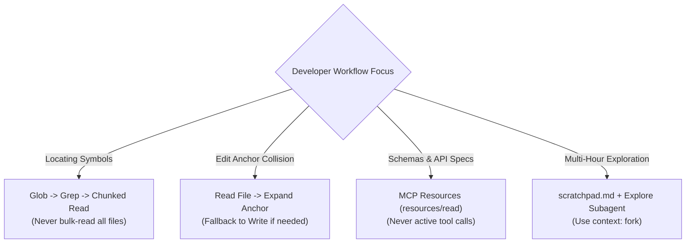
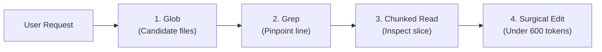
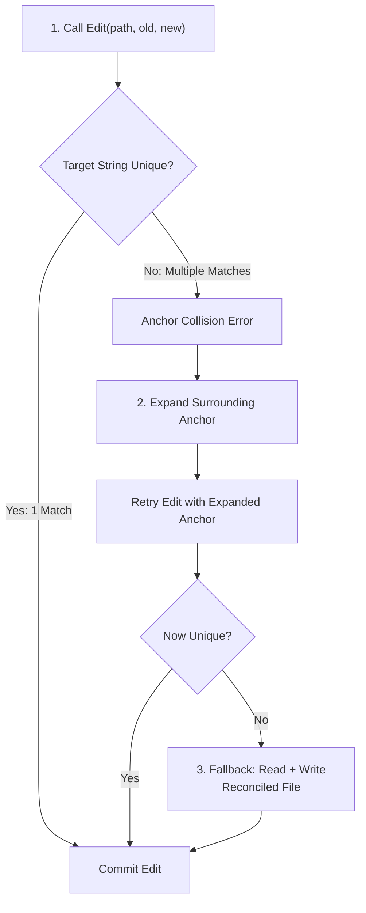

# Scenario 4: Developer Productivity with Claude

## 📌 Executive Architectural Specification & SLAs

We are engineering an AI-augmented developer onboarding and maintenance workflow for large, unfamiliar legacy codebases (100,000+ to 1,000,000+ lines of code). The system empowers software engineers to rapidly locate unfamiliar symbols, trace architectural call chains, and apply precision code edits with zero risk of corrupting untouched methods.

### Quantitative Production SLAs & Non-Negotiables
- **Context Exploration Budget**: Active discovery memory must stay $\le 15,000\text{ tokens}$ per feature investigation (achieved via the `Glob` $\rightarrow$ `Grep` $\rightarrow$ chunked `Read` protocol; strictly **zero full-repository dumping**).
- **Edit Collision Recovery**: $100\%$ automated resolution of ambiguous edit targets via the **Edit Fallback Protocol** (Anchor Expansion $\rightarrow$ `Read` + `Write` fallback).
- **Tool Selection Precision**: Provision agents with **$\le 5$ specialized tools per turn** (Principle of Least Privilege; zero over-provisioning).
- **Static Knowledge Optimization**: Expose large internal API catalogs ($\gt 1\text{MB}$) as read-only **MCP Resources**, never as dozens of executable tool schemas.

### Exam Domain Mapping Matrix
| Exam Domain | Weight | Mapped Task Statements | Architectural Implementation in Scenario 4 |
|---|:---:|---|---|
| **Domain 2: Tool Design & MCP Integration** | 18% | **TS 2.3** (Principle of Least Privilege), **TS 2.4** (MCP Resources vs Tools), **TS 2.5** (Built-in Tools: Glob, Grep, Read, Edit Fallback) | Tool segregation; exposing OpenAPI catalogs via `resources/read`; incremental code navigation; anchor expansion upon multi-match errors. |
| **Domain 1: Agentic Architecture & Orchestration** | 27% | **TS 1.7** (Session State & Speculative Forking) | Forking temporary exploration sessions to inspect legacy architectures without polluting the primary git branch or chat history. |
| **Domain 3: Claude Code Configuration & Workflows** | 20% | **TS 3.4** (Blast Radius & Surgical Edits) | Confining localized single-file fixes to direct surgical execution. |

---

## ⚡ Scenario 4 Golden Rules & Anti-Patterns Reference

### 🏆 The 5 Golden Architectural Rules for Developer Productivity Tools

1. **The 3-Step Incremental Discovery Protocol (`TS 2.5`)**:  
   Never read large files or full directories upfront. Always follow the 3-step discipline: **`Glob`** to find candidate file paths $\rightarrow$ **`Grep`** to pinpoint symbol declarations or error messages $\rightarrow$ **Chunked `Read`** (30–50 lines) to inspect local context.
2. **Least Privilege Tool Provisioning (`TS 2.3`)**:  
   Equip developer agents with **4–5 specialized tools** (`Glob`, `Grep`, `Read`, `Edit`, `Write`). Over-provisioning agents with 15+ tools degrades tool selection accuracy, inflates token overhead, and introduces dangerous execution side effects.
3. **Passive Reference Catalogs as MCP Resources (`TS 2.4`)**:  
   Expose internal API specs, database schemas, and documentation trees as **MCP Resources** (`resources/read`), NOT active tools (`tools/call`). Resources give Claude read-only catalog visibility without triggering multi-turn exploratory tool churn.
4. **The Edit Failure Fallback Protocol (`TS 2.5`)**:  
   When surgical `Edit` fails due to ambiguous anchor collisions or missing unique text, **never retry blindly**. Execute `Read` to retrieve exact line numbers and context, expand the anchor block with unique surrounding code, or fall back to `Write` with reconciled contents.
5. **Persistent Scratchpad External Memory (`TS 5.4`)**:  
   Maintain a persistent `scratchpad.md` in the repository root to document verified facts, key file paths, and interface contracts. In long onboarding sessions, models suffer from context drift; the scratchpad anchors truth outside conversational history.

---

### 🚫 Architectural Anti-Patterns to Reject in Scenario 4 (Exam Distractor Teardown)

| Anti-Pattern | The Exam Distractor Trap (Why Candidates Pick It) | Fatal Production Consequence | Correct Architectural Solution |
|---|---|---|---|
| **Bulk Reading Files Upfront** | Using `Read` or `cat` on entire packages to "understand everything before starting". | Instantly exhausts 40k+ tokens, causes severe "lost-in-the-middle" attention degradation, and hits rate limits. | Apply Incremental Discovery: `Glob` $\rightarrow$ `Grep` $\rightarrow$ chunked `Read`. |
| **Tool Over-Provisioning (15+ Tools)** | Granting all developer tools (terminal, git, linter, docker, k8s, edit, build) to a single agent. | High misrouting rate (Claude calls terminal commands instead of dedicated file tools) and high token cost. | Principle of Least Privilege: restrict to 4–5 specialized built-in file manipulation tools. |
| **Exposing Docs as Active Tools** | Wrapping OpenAPI specifications in a tool `get_api_documentation(endpoint)`. | Forces Claude into 2–3 exploratory round-trips simply to discover available endpoints. | Expose documentation catalogs as passive MCP Resources (`resources/read`). |
| **Blind `Edit` Retrying Without `Read`** | Retrying the identical `Edit` tool invocation after an anchor text mismatch. | Deterministic failure; repeats until turn cap is reached, accomplishing zero work. | Call `Read` to inspect exact line context, expand anchor boundaries, or overwrite via `Write`. |
| **Executing Raw `sed`/`awk` Shell Edits** | Running `sed -i 's/foo/bar/g'` via terminal commands to bypass tool errors. | Bypasses schema validation, destroys undo logging, and risks silent multi-file code corruption. | Use verified file modification tools (`Edit` with fallback to `Write`). |

---

### 🧠 Scenario 4 Rapid Exam Decision Tree



| Scenario Trigger / Condition | Decision Branch | Architectural Action & Distractor Rule |
| :--- | :---: | :--- |
| **Locating symbols in large repositories?** | **PROGRESSIVE DISCOVERY** | `Glob` (paths) $\rightarrow$ `Grep` (lines) $\rightarrow$ chunked `Read` *(NEVER bulk-read all files)*. |
| **Edit tool collision (non-unique anchor text)?** | **SAFE FALLBACK** | Call `Read` to inspect line offsets, expand anchor, or fall back to `Write`. |
| **Exposing company API docs & database schemas?** | **MCP RESOURCES** | Expose via MCP Resources (`resources/read`) *(NEVER active tool calls)*. |
| **Long multi-hour codebase exploration?** | **SCRATCHPAD + SUBAGENT** | Maintain persistent `scratchpad.md` and use Explore subagents with `context: fork`. |


---

## 🔑 Deep Technical Concepts & Anthropic API Structures

### 1. The Incremental Discovery Protocol (TS 2.5)
When a developer asks to fix a bug in an unfamiliar repository, a novice agent attempts to read entire directories or run `cat` on every file. This instantly saturates the context window, triggers "lost in the middle" attention loss, and exhausts token budgets.
- **The 3-Step Incremental Discipline**:
  1. **`Glob` (Path Topology)**: Identify candidate files using path patterns: `Glob(pattern="**/billing/**/*.py")`.
  2. **`Grep` (Symbol Pinpointing)**: Locate the exact line number of the relevant function or error string: `Grep(path="services/billing", pattern="def calculate_sales_tax")`.
  3. **Chunked `Read` (Surgical Slice)**: Inspect only the surrounding 30–50 lines: `Read(path="services/billing/tax.py", offset=140, limit=40)`.



### 2. The Edit Fallback Protocol (TS 2.5)
Claude Code's built-in `Edit` tool performs an exact string replacement (`old_string` $\rightarrow$ `new_string`). To prevent corrupting duplicate lines, the tool strictly requires that `old_string` matches **exactly one location** in the target file.



#### Exact Tool Request: `Edit` Invocation
```json
{
  "name": "Edit",
  "input": {
    "path": "services/billing/calculator.py",
    "old_string": "    return round(amount * rate, 2)",
    "new_string": "    return Decimal(str(amount * rate)).quantize(Decimal('.01'), rounding=ROUND_HALF_UP)"
  }
}
```

#### Collision Error Response from `Edit`
```json
{
  "isError": true,
  "content": [
    {
      "type": "text",
      "text": "Edit failed: The target string occurs 4 times in services/billing/calculator.py. The target string must be unique within the file. Please provide additional surrounding context lines to disambiguate."
    }
  ]
}
```

#### Recovery Request (Expanded Anchor Lines)
```json
{
  "name": "Edit",
  "input": {
    "path": "services/billing/calculator.py",
    "old_string": "def calculate_sales_tax(amount: float, rate: float) -> Decimal:\n    # Standard jurisdiction rounding\n    return round(amount * rate, 2)",
    "new_string": "def calculate_sales_tax(amount: float, rate: float) -> Decimal:\n    # Standard jurisdiction rounding\n    return Decimal(str(amount * rate)).quantize(Decimal('.01'), rounding=ROUND_HALF_UP)"
  }
}
```

### 3. MCP Resources vs. MCP Tools (TS 2.4)
Understanding the architectural boundary between Tools and Resources is a frequent CCAR-F exam topic:

| Dimension | MCP Tools (`tools/call`) | MCP Resources (`resources/read`) |
|---|---|---|
| **Semantics** | Executable actions that accept parameters and cause side-effects. | Static or semi-static read-only reference data loaded via URI. |
| **Example** | `run_unit_tests(suite="billing")`, `git_commit(msg="fix")`. | `spec://openapi/v3/billing.json`, `docs://styleguide/go.md`. |
| **Why for API Specs** | Exposing a 10MB OpenAPI spec as 150 separate tools overwhelms tool selection reasoning and burns prompt tokens. | Exposing the spec as an MCP Resource allows Claude to read only the specific endpoint definition on demand. |

```json
// Example MCP Resource Definition in resources/list
{
  "resources": [
    {
      "uri": "spec://openapi/v3/billing.json",
      "name": "Billing Service OpenAPI 3.0 Specification",
      "mimeType": "application/json",
      "description": "Complete REST API contract, request schemas, and error codes for Billing."
    }
  ]
}
```

### 4. Principle of Least Privilege in Tool Provisioning (TS 2.3)
Equipping an agent with 30 tools simultaneously creates significant degradation:
- Prompt token inflation: Tool definitions consume 3,000–8,000 tokens before conversation even starts.
- Tool selection hallucination: Claude may pick the wrong tool or confuse argument schemas.
- **Production Standard**: Provision only the **4–5 tools strictly required** for the current operational role (e.g. Code Reviewer gets `[Read, Grep, Glob]`; Code Editor gets `[Read, Edit, Write, Bash]`).

### 5. Exact Anthropic `/v1/messages` Tool Definitions Payload
Developer productivity workflows leverage fine-grained tool definitions:

```json
{
  "model": "claude-3-5-sonnet-20241022",
  "max_tokens": 4096,
  "system": [
    {
      "type": "text",
      "text": "You are the Senior Developer Productivity Assistant. Follow the Incremental Discovery Protocol: use Glob to find candidate file paths, Grep to locate exact definitions, and chunked Read to inspect slices. Never read whole repositories into context. Apply surgical edits via Edit; expand surrounding anchor context if duplicate lines collide.",
      "cache_control": {"type": "ephemeral"}
    }
  ],
  "tools": [
    {
      "name": "Glob",
      "description": "Finds files matching a glob pattern across the repository.",
      "input_schema": {
        "type": "object",
        "properties": {
          "pattern": {"type": "string", "description": "Glob pattern (e.g. **/billing/**/*.py)"}
        },
        "required": ["pattern"]
      }
    },
    {
      "name": "Grep",
      "description": "Searches for regex symbols or strings across repository files.",
      "input_schema": {
        "type": "object",
        "properties": {
          "path": {"type": "string"},
          "pattern": {"type": "string"}
        },
        "required": ["path", "pattern"]
      }
    },
    {
      "name": "Read",
      "description": "Reads a slice of a file using 1-indexed offset and line limit.",
      "input_schema": {
        "type": "object",
        "properties": {
          "path": {"type": "string"},
          "offset": {"type": "integer", "minimum": 1},
          "limit": {"type": "integer", "minimum": 1}
        },
        "required": ["path"]
      }
    },
    {
      "name": "Edit",
      "description": "Performs exact string replacement. Requires unique match.",
      "input_schema": {
        "type": "object",
        "properties": {
          "path": {"type": "string"},
          "old_string": {"type": "string"},
          "new_string": {"type": "string"}
        },
        "required": ["path", "old_string", "new_string"]
      }
    },
    {
      "name": "Write",
      "description": "Overwrites full file content. Used as fallback when surgical edits collide.",
      "input_schema": {
        "type": "object",
        "properties": {
          "path": {"type": "string"},
          "content": {"type": "string"}
        },
        "required": ["path", "content"]
      }
    }
  ],
  "tool_choice": {"type": "auto"},
  "messages": [
    {"role": "user", "content": "Update the tax calculation rate from 0.05 to 0.08 in src/billing/calc.py"}
  ]
}
```

### 6. Agent SDK Hook: Whitespace & Newline Normalization (CRLF vs LF)
Discrepancies between host newline formats (Windows `\r\n` vs Linux `\n`) cause silent exact-string match failures. The SDK hook normalizes line endings prior to comparison:

```python
def pre_edit_normalization_hook(tool_name: str, tool_input: dict) -> dict:
    """Normalizes CRLF line endings to prevent false substring collision or missing anchor errors."""
    if tool_name == "Edit":
        tool_input["old_string"] = tool_input["old_string"].replace("\r\n", "\n")
        tool_input["new_string"] = tool_input["new_string"].replace("\r\n", "\n")
    return tool_input
```

---

## 🏗️ Real-World Production Engineering Breakdown

### 1. Detailed System State Machine

```mermaid
stateDiagram-v2
    [*] --> TASK_START: Developer asks to fix bug
    
    state DISCOVERY {
        [*] --> GLOB_PATHS: Glob matching file patterns
        GLOB_PATHS --> GREP_SYMBOLS: Grep symbol or error string
        GREP_SYMBOLS --> CHUNKED_READ: Read offset/limit around target line
        CHUNKED_READ --> [*]
    }
    
    DISCOVERY --> SURGICAL_EDIT: Target lines identified
    
    state SURGICAL_EDIT {
        [*] --> ATTEMPT_EDIT: Call Edit(old_string, new_string)
        ATTEMPT_EDIT --> EDIT_SUCCESS: Target unique (1 match)
        ATTEMPT_EDIT --> COLLISION_DETECTED: Target matches > 1 location
        
        COLLISION_DETECTED --> EXPAND_ANCHOR: Add 2-4 surrounding context lines
        EXPAND_ANCHOR --> ATTEMPT_EDIT_EXPANDED: Call Edit with expanded anchor
        ATTEMPT_EDIT_EXPANDED --> EDIT_SUCCESS: Now unique
        ATTEMPT_EDIT_EXPANDED --> FALLBACK_READ_WRITE: Still ambiguous or multi-line shift
        
        FALLBACK_READ_WRITE --> READ_FULL_FILE: Read entire file into memory
        READ_FULL_FILE --> WRITE_FILE: Write updated content back to disk
        WRITE_FILE --> EDIT_SUCCESS
    }
    
    SURGICAL_EDIT --> VERIFICATION: Run compiler / pytest via Bash
    VERIFICATION --> SURGICAL_EDIT: Test failed (self-repair)
    VERIFICATION --> [*]: Tests pass; commit ready
```



### 2. Comprehensive Edge Cases & Boundary Handling

| Edge Case Scenario | Production Failure Mode (Anti-Pattern) | Robust Architectural Protocol |
|---|---|---|
| **CRLF vs LF Line Endings** | `Edit` fails with string not found because repo uses Windows CRLF and prompt uses LF `\n`. | File reader normalizes line endings on read; `Edit` tool normalizes whitespace and newline characters internally. |
| **Identical Generic Logic** (`return False` appears 40 times in file) | `Edit` fails repeatedly with collision error. | Must expand anchor lines to include the unique enclosing `def function_name(...):` signature. |
| **Catastrophic File Obliteration** | Agent attempts to use `Write` to fix line 50, but writes only the 5 modified lines, erasing the rest of the 1,000-line file. | The runtime enforces file size guards: `Write` triggers a confirmation alert if file size decreases by $> 50\%$ without explicit deletion confirmation. |
| **Path Traversal Attack** (`path: "../../../etc/passwd"`) | Agent reads or overwrites host system files. | Tool sandbox validates that resolved path is strictly within the repository workspace root. |

### 3. Token Budgeting & Memory Preservation Strategy
- **Incremental Discovery vs Full Repo Cat**:
  - Full repo read (150 files): $\sim 180,000\text{ tokens}$ ($\gt \$0.50$ per turn; immediate context saturation).
  - Incremental Protocol (`Glob` $\rightarrow$ `Grep` $\rightarrow$ chunked `Read`): $\le 1,200\text{ tokens}$ ($99.3\%$ cost and memory reduction).
- **Session State Speculative Forking (TS 1.7)**:
  - When exploring speculative architectural approaches (e.g. benchmarking two different ORMs), the agent forks the conversation session (`/fork`).
  - Exploratory logs and failed trial code remain in the ephemeral forked branch. Once the winning solution is verified, only the final clean diff is applied to the main branch.

---

## 🛠️ Hands-On Practical Mini-Lab: Edit Fallback Engine

### The Challenge
Implement the developer productivity toolbox (`DeveloperProductivityToolbox`) that:
1. Provides zero-token-bloat MCP Resource reading (`resources/read`) for static API specs.
2. Implements incremental discovery: `glob_paths` and `grep_symbols` with chunked file reading.
3. Performs exact surgical replacements via `apply_edit()`.
4. Detects multi-match anchor collisions and automatically recovers using expanded anchor lines.
5. Implements recovery step B: falling back cleanly to full-file `read_file()` and `write_file()` with targeted occurrence awareness.

### Running the Mini-Lab & Tests
```bash
# Run the interactive offline simulation
uv run python scenarios/scenario_4_developer_productivity/simulation.py

# Run the 7 unit tests verifying discovery, collision, and targeted fallback
uv run pytest scenarios/scenario_4_developer_productivity/test_scenario_4_simulation.py
```

### Complete Solution Walkthrough

```python
"""
Scenario 4 Mini-Lab: Developer Productivity Toolbox & Edit Fallback Engine
File: scenarios/scenario_4_developer_productivity/simulation.py
"""
import fnmatch
import re
from dataclasses import dataclass
from typing import Any, Dict, List, Optional


@dataclass
class MCPResourceRecord:
    uri: str
    name: str
    mime_type: str
    content: str


class DeveloperProductivityToolbox:
    """Simulates Claude Code's developer productivity toolbox with safe fallbacks and MCP resources."""

    def __init__(self, workspace_files: Dict[str, str]) -> None:
        self.files = dict(workspace_files)
        self.mcp_resources = {
            "resource://specs/openapi.json": MCPResourceRecord(
                uri="resource://specs/openapi.json",
                name="Billing API Spec",
                mime_type="application/json",
                content='{"openapi": "3.0.0", "paths": {"/tax": {"get": {"summary": "Tax calculation"}}}}'
            )
        }

    # 1. MCP Resource Reader (TS 2.4)
    def read_mcp_resource(self, uri: str) -> Dict[str, Any]:
        """Reads static documentation or catalogs as an MCP Resource rather than active tool."""
        if uri not in self.mcp_resources:
            return {"success": False, "error": f"Resource not found: {uri}"}
        res = self.mcp_resources[uri]
        return {"success": True, "uri": res.uri, "name": res.name, "content": res.content}

    # 2. Incremental Discovery: Grep, Glob, and Slices (TS 2.5)
    def glob_paths(self, pattern: str) -> List[str]:
        return [p for p in self.files.keys() if fnmatch.fnmatch(p, pattern)]

    def grep_symbols(self, symbol_regex: str) -> List[Dict[str, Any]]:
        matches = []
        compiled = re.compile(symbol_regex)
        for path, content in self.files.items():
            lines = content.splitlines()
            for line_no, line in enumerate(lines, start=1):
                if compiled.search(line):
                    matches.append({"file": path, "line": line_no, "text": line.strip()})
        return matches

    def read_file_range(self, path: str, offset: int = 1, limit: int = 20) -> Dict[str, Any]:
        if path not in self.files:
            return {"success": False, "error": "File not found"}
        lines = self.files[path].splitlines()
        start = max(0, offset - 1)
        end = min(len(lines), start + limit)
        return {
            "success": True,
            "file": path,
            "lines": lines[start:end],
            "total_lines": len(lines)
        }

    def read_file(self, path: str) -> Dict[str, Any]:
        """Built-in Read tool: reads entire file contents."""
        if path not in self.files:
            return {"success": False, "status": "FILE_NOT_FOUND", "error": f"File '{path}' does not exist."}
        return {"success": True, "path": path, "content": self.files[path]}

    def write_file(self, path: str, content: str) -> Dict[str, Any]:
        """Built-in Write tool: writes entire file contents."""
        self.files[path] = content
        return {"success": True, "status": "WRITTEN", "path": path}

    # 3. Surgical Edit & Fallback Protocol (TS 2.5)
    def apply_edit(self, path: str, old_str: str, new_str: str) -> Dict[str, Any]:
        if path not in self.files:
            return {"success": False, "status": "FILE_NOT_FOUND", "error": "File not found"}
        
        content = self.files[path]
        count = content.count(old_str)

        if count == 0:
            return {"success": False, "status": "NOT_FOUND", "error": "Target string not found in file."}
        if count > 1:
            # Anchor Collision!
            return {
                "success": False,
                "status": "AMBIGUOUS_COLLISION",
                "occurrences": count,
                "error": f"Ambiguous anchor: '{old_str}' matches {count} locations. Expand context or fallback to Read+Write."
            }

        # Unique match: apply safely
        self.files[path] = content.replace(old_str, new_str, 1)
        return {"success": True, "status": "EDITED", "file": path}

    def execute_edit_with_fallback(
        self,
        path: str,
        old_str: str,
        new_str: str,
        expanded_anchor: Optional[str] = None,
        target_occurrence: int = 1,
        full_replacement_content: Optional[str] = None,
    ) -> Dict[str, Any]:
        """Implements the standard Claude Code recovery protocol when Edit encounters collision."""
        if path not in self.files:
            return {"final_status": "FAILED", "error": f"File not found: {path}"}

        # Step 1: Try initial surgical edit
        res1 = self.apply_edit(path, old_str, new_str)
        if res1["success"]:
            return {"final_status": "SURGICAL_EDIT_SUCCESS", "details": res1}

        # Step 2: Try expanded anchor if provided
        if expanded_anchor and expanded_anchor in self.files.get(path, ""):
            expanded_replacement = expanded_anchor.replace(old_str, new_str)
            res2 = self.apply_edit(path, expanded_anchor, expanded_replacement)
            if res2["success"]:
                return {"final_status": "EXPANDED_ANCHOR_SUCCESS", "details": res2}

        # Step 3: Fall back to Read + Write
        read_res = self.read_file(path)
        if not read_res["success"]:
            return {"final_status": "FAILED", "error": read_res.get("error")}

        full_content = read_res["content"]
        if full_replacement_content is not None:
            self.write_file(path, full_replacement_content)
            return {
                "final_status": "FALLBACK_READ_WRITE_SUCCESS",
                "message": "Fell back to Read + Write cleanly with verified full replacement."
            }

        if old_str in full_content:
            parts = full_content.split(old_str)
            if 0 < target_occurrence < len(parts):
                rewritten = (
                    old_str.join(parts[:target_occurrence])
                    + new_str
                    + old_str.join(parts[target_occurrence:])
                )
            else:
                rewritten = full_content.replace(old_str, new_str, 1)

            self.write_file(path, rewritten)
            return {
                "final_status": "FALLBACK_READ_WRITE_SUCCESS",
                "message": f"Fell back to Read + Write cleanly after anchor ambiguity (targeted occurrence {target_occurrence})."
            }

        return {"final_status": "FAILED", "error": "Unable to locate anchor for replacement"}
```

---

## ⚡ The 10-Second Exam Shortcut

| Exam Scenario Stem Clue | The Trap Option to Reject | The Instant Winning Choice | Core Justification |
|---|---|---|---|
| Exploring an unfamiliar 500k LOC legacy codebase | Run `cat *` or read all files in the directory | **Incremental Discovery**: `Glob` $\rightarrow$ `Grep` $\rightarrow$ chunked `Read` | Reading full repos blows context and triggers "lost in the middle" (**TS 2.5**). |
| `Edit` tool fails: *"Target string matches 3 locations"* | Force `Write` immediately without checking or guessing line | **Anchor Expansion**: Add 2–4 lines of unique surrounding code | Expanding anchor disambiguates duplicate strings safely (**TS 2.5**). |
| Exposing a 10MB internal OpenAPI spec to Claude | Expose all 200 endpoints as individual executable MCP Tools | Expose spec as a read-only **MCP Resource** (`spec://...`) | Large static catalogs belong in Resources, not executable tool definitions (**TS 2.4**). |
| Configuring tools for a specialized Code Reviewer bot | Give the reviewer 35 tools including database drop and bash | Provision **4–5 specialized tools** (`[Read, Grep, Glob]`) | Principle of Least Privilege prevents misrouting and context bloat (**TS 2.3**). |
| Testing speculative refactoring without risking main branch | Execute edits directly in the main conversation session | **Fork session context** (`/fork` or `context: fork`) | Forked sessions isolate speculative failures from primary history (**TS 1.7**). |

---

## 🎯 Substantive Exam Practice: 10 Scenario Questions

### Question 4.1
**Scenario**: You are tasked with resolving a bug in a 200,000-line legacy Python application where invoices calculate sales tax incorrectly. You do not know which file defines the tax calculation. What is the most token-efficient discovery sequence?

- **A)** Read all `.py` files in the repository using sequential `Read` tool invocations.
- **B)** Run `Glob(pattern="**/*tax*.py")` to narrow down file paths, run `Grep(path="...", pattern="def calculate_tax")` to pinpoint the exact line, and run `Read(path="...", offset=120, limit=35)` to inspect the function. *(Correct)*
- **C)** Ask the developer to paste the entire repository into the chat prompt.
- **D)** Run a recursive bash script that deletes files until the bug disappears.

> **Deep Architectural Rationale**: Under **TS 2.5**, the Incremental Discovery Protocol (`Glob` $\rightarrow$ `Grep` $\rightarrow$ chunked `Read`) keeps exploratory token expenditure under 1,500 tokens. Reading the entire repository burns hundreds of thousands of tokens, costs substantial compute, and causes the model to suffer from "lost in the middle" attentional degradation.  
> **Exhaustive Distractor Teardown**:
> - *Option A is incorrect*: Reading every file in a 200,000 LOC repo exhausts the context window immediately.
> - *Option C is incorrect*: Pasting an entire repository into a prompt is impractical and exceeds prompt limits.
> - *Option D is incorrect*: Deleting code files is destructive and absurd.

---

### Question 4.2
**Scenario**: When executing `Edit` to update a return statement in `billing.py`, the tool returns: `Edit failed: The string '    return False' occurs 8 times in billing.py`. What is the immediate correct recovery action under the Edit Fallback Protocol?

- **A)** Re-invoke `Edit` with an expanded anchor string that includes 2–4 lines of unique surrounding context, such as the enclosing `def validate_promo_code(...):` function header. *(Correct)*
- **B)** Run `Write` to overwrite `billing.py` with only the single line `return False`.
- **C)** Terminate the debugging session and declare the codebase unmaintainable.
- **D)** Delete the other 7 occurrences of `return False` so the target becomes unique.

> **Deep Architectural Rationale**: Under **TS 2.5**, Claude Code's `Edit` tool requires unique target strings to prevent unintended replacements. When a target matches multiple locations, Recovery Step A is **Anchor Expansion**—adding unique surrounding lines (like function definitions or comments) to create a unique anchor.  
> **Exhaustive Distractor Teardown**:
> - *Option B is incorrect*: Overwriting the file with a single line obliterates the entire module.
> - *Option C is incorrect*: Edit collisions are routine occurrences that the agent must resolve autonomously.
> - *Option D is incorrect*: Deleting unrelated return statements breaks the other 7 functions in the file.

---

### Question 4.3
**Scenario**: An enterprise engineering team wants to make their internal REST API documentation (a 12 MB OpenAPI 3.0 JSON specification containing 250 endpoints) available to Claude Code. How should this be integrated under the Model Context Protocol (MCP)?

- **A)** Expose all 250 endpoints as 250 individual executable MCP Tools inside the agent's prompt.
- **B)** Expose the OpenAPI specification as an **MCP Resource** (`spec://internal/v3/openapi.json`), allowing Claude to query and read relevant schema paths on demand. *(Correct)*
- **C)** Paste the entire 12 MB JSON file into the root `CLAUDE.md`.
- **D)** Convert the OpenAPI JSON into a 500-page PDF and email it to Anthropic support.

> **Deep Architectural Rationale**: Under **TS 2.4**, static or semi-static reference data must be exposed as **MCP Resources**, not active tools. Provisioning 250 executable tool schemas consumes tens of thousands of tokens on every turn and severely degrades Claude's tool selection reasoning. MCP Resources allow lazy, on-demand reading via standard URIs.  
> **Exhaustive Distractor Teardown**:
> - *Option A is incorrect*: Provisioning 250 tools causes severe tool hallucination and prompt token exhaustion.
> - *Option C is incorrect*: Pasting 12 MB into `CLAUDE.md` exceeds token limits and ruins session memory.
> - *Option D is incorrect*: PDFs sent via email cannot be queried programmatically by an active agent.

---

### Question 4.4
**Scenario**: You are configuring a specialized automated Code Linter agent that reviews PRs for security and formatting issues. Which set of tools represents adherence to the Principle of Least Privilege?

- **A)** `[Read, Grep, Glob, Bash, Edit, Write, DropDatabase, DeployToProd]`
- **B)** `[Read, Grep, Glob]` *(Correct)*
- **C)** `[Bash]` with unrestricted `sudo` permissions.
- **D)** No tools; provide the entire codebase in the system prompt.

> **Deep Architectural Rationale**: Under **TS 2.3**, agents must only be provisioned with tools necessary for their designated role. A code review and linting agent only needs read-only discovery tools (`Read`, `Grep`, `Glob`). Giving a reviewer agent destructive write or deployment tools violates least privilege and creates severe security hazards.  
> **Exhaustive Distractor Teardown**:
> - *Option A is incorrect*: Provisioning production deployment and database drop tools to a linter bot is an extreme security violation.
> - *Option C is incorrect*: Granting unrestricted sudo shell access exposes the host system to arbitrary command execution.
> - *Option D is incorrect*: Dumping full codebases into system prompts wastes context and prevents targeted file inspection.

---

### Question 4.5
**Scenario**: An engineer wants to explore an experimental refactor of a legacy service to compare async/await vs threading, without risking their current debugging conversation history or git branch. How should they manage the session?

- **A)** Fork the session using Claude Code's session forking capability (`/fork` or `context: fork`), run the speculative experiments in the child context, and bring back only the winning design. *(Correct)*
- **B)** Run the experiments directly in the main chat and scroll past the error logs later.
- **C)** Manually delete the conversation history JSON file from their computer.
- **D)** Create a new GitHub account and start over.

> **Deep Architectural Rationale**: Under **TS 1.7**, session state forking creates an isolated child execution branch. Speculative exploration, trial implementations, and voluminous diagnostic output remain inside the forked context, keeping the parent conversation clean, focused, and free of token bloat.  
> **Exhaustive Distractor Teardown**:
> - *Option B is incorrect*: Polluting the main chat with dozens of failed trial runs wastes memory and confuses the model in subsequent turns.
> - *Option C is incorrect*: Deleting configuration files locally breaks the active session state.
> - *Option D is incorrect*: Creating new user accounts is an absurd and unnecessary reaction to session management.

---

### Question 4.6
**Scenario**: While using `Read` to inspect a 5,000-line legacy file, Claude receives an error indicating the file exceeds the single-read byte limit. How should the agent proceed?

- **A)** Run `Read` with explicit pagination parameters: `offset=1` and `limit=200`, chunking through only the relevant section identified by `Grep`. *(Correct)*
- **B)** Delete the first 4,000 lines of the file using a bash script so the file fits in memory.
- **C)** Terminate execution immediately.
- **D)** Convert the file into an MP3 audio file.

> **Deep Architectural Rationale**: Under **TS 2.5**, the `Read` tool supports chunked reads via `offset` (starting line) and `limit` (number of lines). By combining `Grep` (to find the line number of interest) with chunked `Read`, the agent inspects only the targeted slice without reading the full 5,000 lines.  
> **Exhaustive Distractor Teardown**:
> - *Option B is incorrect*: Deleting source code corrupts the application.
> - *Option C is incorrect*: Hitting a byte limit is a standard condition that should be handled via pagination.
> - *Option D is incorrect*: Converting code to audio is completely nonsensical.

---

### Question 4.7
**Scenario**: What is the primary operational hazard of replacing surgical `Edit` operations with wholesale `Write` operations across an entire codebase?

- **A)** `Write` runs slower on CPU hardware.
- **B)** Wholesale `Write` replaces the entire file contents; if the model hallucinates or truncates any part of the file, untouched legacy methods, edge-case handlers, and comments are permanently erased. *(Correct)*
- **C)** `Write` requires root administrator privileges on Linux.
- **D)** `Write` can only be called once per day per user.

> **Deep Architectural Rationale**: Under **TS 2.5**, `Edit` is surgical—it replaces only the specified target string while leaving the remaining 99% of the file untouched. In contrast, `Write` completely overwrites the target file with the generated string. If Claude truncates its output (e.g. `// ... existing code ...`), the omitted code is lost.  
> **Exhaustive Distractor Teardown**:
> - *Option A is incorrect*: Disk I/O performance differences are negligible.
> - *Option C is incorrect*: Standard file write tools operate under the user's workspace permissions, not root.
> - *Option D is incorrect*: Tool calls are not restricted to once-per-day quotas.

---

### Question 4.8
**Scenario**: In a Windows environment, Claude Code's `Edit` tool consistently fails with `old_string not found`, even though the developer visually sees the exact line in the file. What is the most likely technical cause?

- **A)** Windows uses CRLF (`\r\n`) line endings, while Claude generated the `old_string` with Unix LF (`\n`) newlines. *(Correct)*
- **B)** Claude models cannot run on Windows operating systems.
- **C)** The file is encrypted with BitLocker.
- **D)** The Anthropic API blocks Windows developers.

> **Deep Architectural Rationale**: Line ending discrepancies (CRLF vs LF) are a classic cross-platform issue in surgical text editing. The `Edit` tool performs an exact character-for-character substring match. If the file on disk has `\r\n` and the tool input provides `\n`, the substring match fails. Robust tools normalize newlines prior to matching.  
> **Exhaustive Distractor Teardown**:
> - *Option B is incorrect*: Claude and Claude Code run on Windows, macOS, and Linux.
> - *Option C is incorrect*: BitLocker operates transparently at the volume level and does not alter string text.
> - *Option D is incorrect*: Anthropic APIs are platform-agnostic HTTP/REST endpoints.

---

### Question 4.9
**Scenario**: You need to implement a tool that allows Claude Code to execute unit tests. How should the tool input schema be constrained to enforce security?

- **A)** Accept an arbitrary bash string: `{"cmd": "string"}` and execute it with `shell=True`.
- **B)** Restrict input parameters to a strictly typed enum of pre-approved test suites: `{"suite": {"type": "string", "enum": ["unit", "integration", "lint"]}}`, executing the command via fixed parameter bindings without a shell. *(Correct)*
- **C)** Allow Claude to run any command as long as it starts with `sudo`.
- **D)** Remove all security checks to speed up testing.

> **Deep Architectural Rationale**: Under **TS 2.1** and **TS 2.3**, tool parameters must be tightly constrained using strict JSON schemas. Permitting arbitrary shell strings invites prompt injection and arbitrary command execution. Restricting inputs to specific enums with parameterized execution guarantees command injection safety.  
> **Exhaustive Distractor Teardown**:
> - *Option A is incorrect*: Executing arbitrary strings via `shell=True` is a severe remote code execution vulnerability.
> - *Option C is incorrect*: Granting `sudo` elevates the blast radius of any compromised execution.
> - *Option D is incorrect*: Disabling security checks exposes infrastructure to exploitation.

---

### Question 4.10
**Scenario**: When applying the Edit Fallback Protocol, Recovery Step A (Anchor Expansion) fails because the surrounding 10 lines also repeat across multiple classes. What is Recovery Step B?

- **A)** Terminate the process and delete the git repository.
- **B)** Read the full file into memory via `Read`, perform the replacement in memory, and commit the complete file using `Write`. *(Correct)*
- **C)** Ask the developer to rewrite the file in a different programming language.
- **D)** Lower model temperature to -1.0.

> **Deep Architectural Rationale**: Under **TS 2.5**, when Anchor Expansion is insufficient to disambiguate identical repetitive code blocks, the protocol falls back to **Read + Write**. The agent reads the complete file into memory, identifies the exact AST or line index intended, updates the content in memory, and writes the entire file back to disk.  
> **Exhaustive Distractor Teardown**:
> - *Option A is incorrect*: Deleting the repository is destructive and unacceptable.
> - *Option C is incorrect*: Demanding a language rewrite is completely unhelpful.
> - *Option D is incorrect*: Temperature cannot be negative.

---

## 🎤 Senior Architect Interview Defense (Socratic Grilling)

### Defense 1: Incremental Discovery vs. Full Repository Context
**Interviewer**: *"Modern LLMs have 200k to 1M token context windows. Why mandate a multi-step `Glob` $\rightarrow$ `Grep` $\rightarrow$ chunked `Read` workflow instead of simply dumping all files into the prompt?"*

**Architect Defense**:
> "Large context windows provide capacity, not immunity from physical and cognitive limitations. Dumping an entire 200,000 LOC repository into context introduces three critical production penalties:
> 1. **Financial Overhead**: At \$3 per million input tokens, ingesting 150k tokens on every turn across a 15-turn debugging session costs over \$6 per bug fix. Incremental discovery costs less than \$0.05.
> 2. **Latency**: Loading 150k tokens adds 4–8 seconds of prompt evaluation latency to every turn.
> 3. **Attentional Diffusion**: Flooding the prompt with hundreds of irrelevant classes causes 'lost in the middle' degradation, increasing the chance that Claude overlooks subtle bug conditions."

### Defense 2: Surgical Edit vs. Full File Overwrite
**Interviewer**: *"Why not just always use `Write` to overwrite the entire file? It's much simpler than dealing with `Edit` anchor collisions and fallback protocols."*

**Architect Defense**:
> "Wholesale `Write` is one of the most dangerous anti-patterns in automated coding. When an agent rewrites a 1,000-line file just to modify 3 lines, it must accurately reproduce the other 997 lines. If the model truncates output, hallucinates a method signature, or replaces a helper function with `// ... rest of code`, production logic is silently erased. Surgical `Edit` acts like a localized `git patch`—guaranteeing that untouched methods remain 100% byte-for-byte identical."
