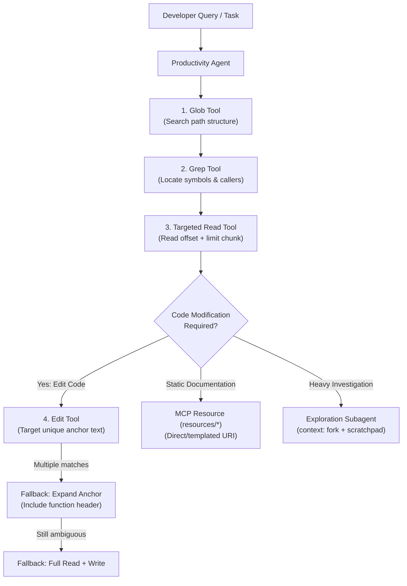
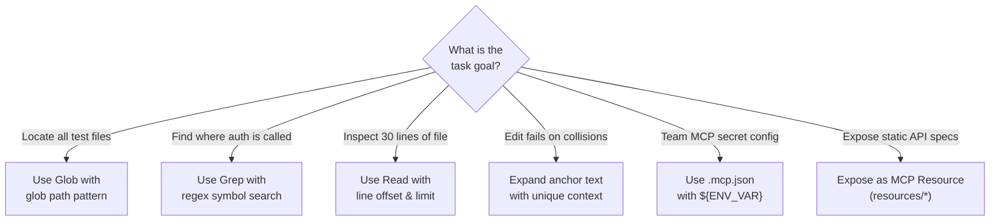

# Scenario 4: Developer Productivity with Claude

## 1. In One Minute

**What it is.** An enterprise developer productivity assistant that navigates large, unfamiliar, or legacy codebases. The agent uses built-in exploration tools (`Glob`, `Grep`, `Read`, `Edit`, `Write`, `Bash`) and Model Context Protocol (MCP) integrations to understand architecture, debug issues, and safely refactor code without blowing context budgets or corrupting source files.

**Domains hit:** Domain 2 (Tool Design & MCP Integration), Domain 3 (Claude Code Configuration & Workflows), Domain 1 (Agentic Architecture & Orchestration).

**Key Task Statements:** TS 2.3 (Tool distribution & scoping), TS 2.4 (MCP server & resource integration), TS 2.5 (Built-in code tools execution order), TS 3.1 (`CLAUDE.md` context loading), TS 1.7 (Session management & branching), TS 5.1 (Context window preservation).

**Top 3 Traps:**
1. **The Brute-Force Reading Trap**: Ingesting whole directory trees or entire multi-thousand-line files into context when `Glob` (file names) or `Grep` (text patterns) would locate the exact target in milliseconds for a fraction of the token cost.
2. **The Hardcoded MCP Secret Trap**: Committing API tokens or database passwords directly into `.mcp.json` instead of using environment variable expansion (`${JIRA_API_TOKEN}`).
3. **The Anchor Collision Trap**: Repeating a failed `Edit` tool invocation with the exact same non-unique target string rather than following the 3-stage fallback ladder.

---

## 2. Architecture Diagram



---

## 3. How a Good Answer Thinks

Follow this decision sequence on the CCAR-F exam:

1. **Match the Tool to the Objective (The Discovery Funnel)**:
   * Need file names, file existence, or structural layout? → `Glob`.
   * Need symbol definitions, usages, or string callers across the repo? → `Grep`.
   * Need to understand logic in a specific file? → `Read` (targeted with offset/limit).
   * Need to modify existing code? → `Edit` (requires an exact, unique target anchor).
2. **The 3-Stage Edit Fallback Ladder**:
   * Stage 1: Invoke `Edit` with target text.
   * Stage 2 (If target appears multiple times): Expand the anchor text to include unique surrounding lines (e.g. enclosing function header or decorator).
   * Stage 3 (If still ambiguous): Perform a fresh `Read` of the complete file and use `Write` to replace the full content cleanly.
3. **MCP Configuration and Credential Governance**:
   * Shared team integrations live in version-controlled `.mcp.json` at the repo root.
   * Secrets must NEVER be in `.mcp.json`; always use `${ENV_VAR}` syntax.
   * Static documentation, database schemas, and architectural wikis belong in **MCP Resources** (`resources/*`), not tools.
4. **Context Hygiene in Deep Investigations**:
   * Offload verbose grep or ast logs to a subagent (`context: fork`).
   * Record key architectural discoveries in an external `scratchpad.md` file rather than bloating active conversational memory.
5. **Least Privilege**: Read-only investigation agents must NEVER be provisioned with `Write`, `Edit`, or unrestricted `Bash` tools.



---

## 4. Task Statement Map

| Task Statement | How It Manifests in Scenario 4 | Exam Trap |
| :--- | :--- | :--- |
| **TS 2.3 Tool Scoping** | Read-only explorer receives strictly `Glob`, `Grep`, `Read`. | Granting `Write` and unrestricted `Bash` to a read-only investigation. |
| **TS 2.4 MCP Integration** | Project `.mcp.json` using `${ENV_VAR}` for tokens; resources for specs. | Hardcoding API keys in `.mcp.json` or putting team configs in `~/.claude/`. |
| **TS 2.5 Built-In Tools** | Proper tool sequencing: `Glob` → `Grep` → `Read` → `Edit`. | Reading every file in the repo; using `Bash(cat ...)` instead of `Read`. |
| **TS 3.1 `CLAUDE.md`** | Invariant repository build and architectural conventions loaded at launch. | Re-explaining repo structure and test commands on every turn. |
| **TS 1.7 Session Branching** | Using subagents or session branching to test alternative refactors. | Starting over from scratch and losing previous exploratory findings. |
| **TS 5.1 Context Hygiene** | Subagent summaries and persistent `scratchpad.md` notes. | Flooding the main conversation session with 5,000 lines of raw grep output. |

---

## 5. Step-by-Step Worked Example

**Developer Objective**: *"Where is tax calculated in this legacy billing repository, and can we safely increase the default rate to 6%?"*

1. **Structural Discovery**: The agent calls `Glob(pattern="src/**/billing*")`. It identifies `src/services/billing/calc.py` and `src/services/billing/invoice.py`.
2. **Symbol Mapping**: The agent calls `Grep(pattern="calculate_tax|tax_rate", path="src/")`. It finds:
   * Definition: `src/services/billing/calc.py` (Line 42)
   * Caller: `src/services/billing/invoice.py` (Line 115)
3. **Targeted Reading**: The agent calls `Read(file_path="src/services/billing/calc.py", offset=35, limit=20)`. It reads only the relevant 20 lines rather than the entire 1,500-line file.
4. **MCP Resource Inspection**: To verify regulatory rules, the agent accesses an MCP resource `docs://specs/billing_tax_compliance` to confirm whether tax rates must be configured as floats or decimal objects.
5. **Executing the Edit & Handling Collision**:
   * The agent attempts: `Edit(file_path="calc.py", target="return 0.05", replacement="return 0.06")`.
   * The tool fails: `"Target string 'return 0.05' matches 2 occurrences in calc.py"`.
   * **Stage 2 Fallback**: The agent expands the anchor to include the function header:
     ```python
     target = """def get_default_tax_rate():
         return 0.05"""
     replacement = """def get_default_tax_rate():
         return 0.06"""
```
   * The edit succeeds cleanly with zero ambiguity.
6. **Verification & Note Capture**: The agent executes tests via `Bash(command="pytest tests/test_billing.py")`. Tests pass. The agent writes a summary note to `scratchpad.md` documenting the dependency chain between `calc.py` and `invoice.py`.

---

## 6. Exam-Style Practice Questions with Distractor Teardowns

### Q1. Efficient Codebase Navigation
You are assigned to locate every caller of a deprecated function `process_payment_v1()` in a legacy repository containing 4,000 files across 80 directories. What is the most efficient, cost-effective first step?

- **A)** Call `Read` on every Python file under `src/`.
- **B)** Ask the developer in chat to provide a list of callers.
- **C)** Execute a bash command that runs `cat` on all files and pipe it into the LLM context.
- **D)** Call `Grep` with pattern `"process_payment_v1"` to locate matching file paths and line numbers, then `Read` only the matching files.

**Correct Answer:** D

**Distractor Teardown:**
- **A is incorrect (The Brute-Force Reading Trap):** Reading 4,000 files consumes tens of millions of tokens, costs hundreds of dollars, and crashes context limits.
- **B is incorrect:** The user tasked the assistant with discovering this; asking the user defeats the purpose of developer automation.
- **C is incorrect:** Using `cat` to dump files into bash output causes the exact same massive context flood as Option A.
- **D is correct (Progressive Discovery):** `Grep` executes deterministically in host code, returning only matching line references without loading irrelevant files into LLM context.

---

### Q2. Selecting File Finding Tools
You need to find all integration test files in a repository matching the naming convention `*.integration.spec.ts`. Which tool should be invoked?

- **A)** `Grep` with search string `"integration"`.
- **B)** `Glob` with pattern `"**/*.integration.spec.ts"`.
- **C)** `Read` targeting the repository root directory.
- **D)** `Bash` executing a recursive Python script that walks the filesystem.

**Correct Answer:** B

**Distractor Teardown:**
- **A is incorrect:** `Grep` searches the *content* inside files, not file names and path structures.
- **B is correct:** `Glob` is the purpose-built tool for pattern-matching filesystem paths and file names.
- **C is incorrect:** `Read` opens file contents; passing a directory path to `Read` returns a filesystem error.
- **D is incorrect:** Writing custom Python scripts is an over-engineered anti-pattern when a native `Glob` tool is available.

---

### Q3. Recovering from Edit Anchor Collisions
An `Edit` tool execution fails with the error message:
`"Target string 'status = True' appears 4 times in user_service.py. Target must be unique."`
What is the proper recovery procedure?

- **A)** Re-issue the exact same `Edit` call immediately.
- **B)** Delete `user_service.py` and rewrite the entire file from memory.
- **C)** Expand the target anchor to include surrounding unique lines (such as function declarations or unique variable assignments); if still ambiguous, perform a targeted `Read` and replace via `Write`.
- **D)** Halt execution and tell the user the file cannot be modified.

**Correct Answer:** C

**Distractor Teardown:**
- **A is incorrect:** Repeating the identical call will fail with the identical collision error.
- **B is incorrect:** Deleting files destroys production code and introduces severe hallucination risks.
- **C is correct (The Edit Fallback Ladder):** Expanding surrounding anchor context creates a unique string match. If context remains ambiguous, a full read-and-write replaces the file deterministically.
- **D is incorrect:** Giving up on a routine string collision represents fragile agent engineering.

---

### Q4. Shared Team MCP Configuration & Secrets
A team wants to integrate an internal Jira MCP server for all engineers working on a shared repository. The server requires an authentication token. What is the correct architectural configuration?

- **A)** Configure the server in each developer's personal `~/.claude/config.json`.
- **B)** Commit the server definition in the repository's `.mcp.json`, referencing the token via environment variable expansion: `"token": "${JIRA_API_TOKEN}"`.
- **C)** Paste the raw plaintext API token directly into the committed `.mcp.json`.
- **D)** Hardcode the API token inside the assistant's system prompt in `CLAUDE.md`.

**Correct Answer:** B

**Distractor Teardown:**
- **A is incorrect:** User-level configs do not synchronize across the Git repository, forcing manual setup for every team member.
- **C is incorrect (The Hardcoded Secret Trap):** Committing raw credentials into version control leaks secrets across Git history.
- **D is incorrect:** Pasting credentials in prompts leaks secrets across LLM API boundaries and wastes prompt tokens.
- **B is correct:** Committing `.mcp.json` standardizes tool access for the entire team, while `${ENV_VAR}` ensures credentials stay secure in developer environment variables.

---

### Q5. Context Preservation During Deep Code Exploration
An agent is tasked with tracing a complex legacy dependency graph. After 30 exploratory grep and read tool calls, the conversation context is cluttered with 60,000 tokens of raw source snippets, and the agent begins losing track of its original goal. What architectural design prevents this?

- **A)** Increase the model's `max_tokens` output limit.
- **B)** Delete the initial user prompt from the conversation history.
- **C)** Delegate exploratory investigation to an isolated subagent (`context: fork`) that returns only a synthesized summary, and persist key findings in an external `scratchpad.md` file.
- **D)** Restart the machine and instruct the agent to avoid reading files.

**Correct Answer:** C

**Distractor Teardown:**
- **A is incorrect:** `max_tokens` limits generation output; it does not solve input context bloat.
- **B is incorrect:** Deleting the initial prompt causes amnesia regarding the user's primary objective.
- **C is correct (Isolated Exploration & Scratchpads):** Running exploratory lookups in a forked subagent keeps intermediate noise out of the primary session, while `scratchpad.md` preserves findings durably.
- **D is incorrect:** Avoiding file reads prevents the agent from performing necessary software engineering work.

---

### Q6. Exposing Internal Knowledge: Tools vs. Resources
An enterprise maintains static OpenAPI specifications and architecture decision records (ADRs) that developers frequently need. How should these documents be exposed through MCP?

- **A)** Expose them as MCP Resources (`resources/*`), allowing the model to browse and attach document URIs directly into context without exploratory tool calls.
- **B)** Wrap every document in an executable MCP Tool that requires the model to guess search parameters.
- **C)** Paste all OpenAPI specifications directly into the system prompt of `CLAUDE.md`.
- **D)** Store the documents in an encrypted archive that the agent cannot reach.

**Correct Answer:** A

**Distractor Teardown:**
- **A is correct (MCP Resources for Static Data):** MCP Resources act as read-only context endpoints (like GET endpoints). Exposing specs as resources allows the host to list and attach documentation cleanly without tool guessing.
- **B is incorrect:** Tool wrapping requires iterative guess-and-check calling, burning latency and token budgets.
- **C is incorrect:** Pasting full OpenAPI specifications into `CLAUDE.md` causes severe prompt bloat on every interaction.
- **D is incorrect:** Unreachable archives eliminate developer productivity benefits.

---

## 7. Self-Check Checklist

- [ ] I can recite the progressive discovery funnel: `Glob` (names) → `Grep` (content) → `Read` (targeted lines) → `Edit` (anchored write).
- [ ] I know the 3-stage fallback ladder for `Edit` collisions.
- [ ] I understand how `.mcp.json` uses `${ENV_VAR}` to protect credentials.
- [ ] I know why static documentation belongs in MCP Resources rather than Tools.
- [ ] I use `scratchpad.md` and forked subagents to protect the main session from exploratory noise.

**Memory Hook:** *"Glob names, Grep content, Read last, Edit with a unique anchor."*

**Related Practice Bank Questions:**
* [Set 4 (CLAUDE.md & Rules): Q101, Q102, Q104, Q116](../../practice_exam_bank_300/set_04_domain2_claude_code_config.md)
* [Set 8 (Tool Schemas & Error Handling): Q216, Q225, Q234](../../practice_exam_bank_300/set_08_domain4_tool_schemas_error_handling.md)
* [Set 9 (MCP Architecture & Stateless Spec): Q246, Q247, Q251, Q252, Q261, Q263](../../practice_exam_bank_300/set_09_domain4_mcp_architecture_stateless.md)
