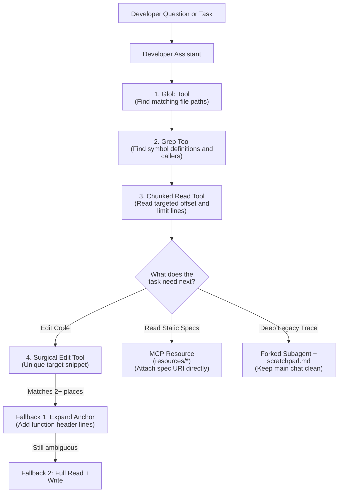
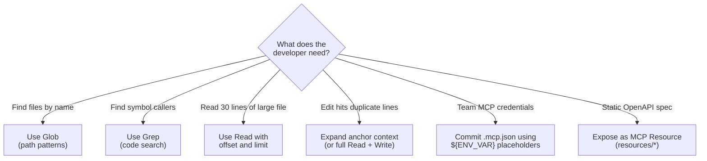

# Scenario 4: Developer Productivity with Claude

## 1. The Big Picture (In Plain English)

Picture an engineer joining a massive legacy repository with 4,000 files and needing to find where tax logic lives, understand the API rules, and change one rate safely without breaking callers or flooding the chat window. Claude handles this using built-in file tools (`Glob`, `Grep`, `Read`, `Edit`, `Write`, `Bash`) paired with **MCP (Model Context Protocol)** connections to external docs and issue trackers.

**Everyday Analogy — Map, Magnifying Glass, and Scalpel:**
You do not inspect a warehouse by opening every single box on day one. First you look at the floor map (`Glob` to find file names), then you use a magnifying glass to pinpoint the exact shelf (`Grep` to find symbols), then you open only that box (`Read` with line offsets), and finally you make one clean adjustment (`Edit` with a unique anchor).

- **Domains Tested:** Domain 2 (Tool Design & MCP, 18%), Domain 3 (Claude Code Configuration, 20%), Domain 1 (Agentic Architecture, 27%).
- **Task Statements:** TS 2.3 (Tool scoping), TS 2.4 (MCP configs & Resources), TS 2.5 (Built-in tools & Edit fallback), TS 3.1 (`CLAUDE.md`), TS 1.7 (Session forking), TS 5.1 (Context hygiene).

### Top 3 Mistakes to Watch Out For
1. **Reading whole directories upfront:** Loading dozens of full files on turn 1 wastes tens of thousands of tokens and drowns out the actual bug. Search paths and symbols first.
2. **Hardcoding secrets in `.mcp.json`:** Committing real API tokens into a shared `.mcp.json` leaks credentials into Git history. Always use `${ENV_VAR}` placeholders.
3. **Retrying a colliding `Edit` blindly:** If `Edit` fails because a short line like `return False` appears 8 times, repeating the exact same call fails again. Expand the surrounding context—or read the whole file and rewrite it cleanly.

---

## 2. How the System Works



### Walkthrough of the Flow
1. **Narrow down with `Glob` and `Grep` first:** Use `Glob` when you know the file naming pattern (like `**/*.spec.ts`) and `Grep` when you know a function or symbol name.
2. **Read only the lines you need:** Call `Read` with `offset` and `limit` around the matching line numbers instead of loading an entire 5,000-line file.
3. **Use the 3-step `Edit` fallback ladder:** Try a targeted `Edit` first; if the target text appears multiple times, add 2–4 unique surrounding lines; if it is still ambiguous, read the full file with `Read` and write the updated file with `Write`.
4. **Keep reference docs and deep traces tidy:** Expose static OpenAPI specs or schemas as **MCP Resources**, and send noisy dependency traces to a forked subagent (`context: fork`) plus a `scratchpad.md` file.

---

## 3. Core Design Rules (Why Naive Fixes Fail)

1. **Follow the Discovery Order (`Glob` → `Grep` → `Read` → `Edit`):**
   - Need file paths or folder layout? Use `Glob`.
   - Need where a function is defined or called? Use `Grep`.
   - Need to read code in a specific spot? Use `Read` (with `offset` and `limit` for large files, never `Bash("cat ...")`).
2. **Recover cleanly from `Edit` collisions:**
   - **Step 1:** Run `Edit` with the target lines.
   - **Step 2:** If `Edit` says the string appears multiple times, expand the anchor to include unique lines above or below (such as the enclosing `def` or decorator).
   - **Step 3:** If surrounding lines also repeat (or line endings differ, like Windows `\r\n` vs. Unix `\n`), read the full file via `Read`, apply the change in memory, and save with `Write`. Never use wholesale `Write` as your *first* choice—it risks dropping untouched methods if output truncates.
3. **Keep shared MCP configs safe and portable:**
   - Commit shared team servers in the repo's `.mcp.json`.
   - Never hardcode secrets; write `"token": "${JIRA_API_TOKEN}"` so each developer's local environment supplies the key.
   - Expose static API catalogs, database schemas, and ADRs as **MCP Resources** (`resources/*`) rather than building dozens of separate search tools.
4. **Protect the main chat from exploration noise:**
   - Run sprawling codebase audits in an isolated subagent (`context: fork`) so thousands of lines of search hits stay out of main history.
   - Save confirmed findings in a `scratchpad.md` file, and use session forking (`--fork-session` / `fork_session=True` plus a separate git branch) when testing an experimental refactor.
5. **Apply Least Privilege to read-only tasks:**
   - A security auditor or code explorer should receive only `[Read, Grep, Glob]`, never `Edit`, `Write`, or unrestricted `Bash`.
   - For tools that run tests, use a strict enum (e.g., `["unit", "integration", "lint"]`) executed without a raw shell instead of accepting arbitrary bash strings.



### Model & API Rules for This Scenario
- **Model choice:** Use `claude-sonnet-4-5` for planning, debugging, and complex refactoring; use `claude-haiku-4-5` for fast, narrow lookup tasks.
- **Session vs. files:** Forking a Claude session (`--fork-session`) branches **conversation history only**—it does not copy files on disk, so pair it with a separate `git branch` when testing risky edits.

---

## 4. What the Exam Tests (Task Statement Map)

| Task Statement | How It Shows Up Here | Tempting Wrong Answer |
| :--- | :--- | :--- |
| **TS 2.3 Tool Scoping** | Read-only explorers get only `Glob`, `Grep`, `Read`; test tools use strict enums. | Giving `Bash` or `Write` to a read-only reviewer, or accepting raw shell strings. |
| **TS 2.4 MCP & Resources** | Shared `.mcp.json` with `${ENV_VAR}`; static specs exposed as MCP Resources. | Committing raw API tokens in `.mcp.json`, or wrapping 250 API endpoints as 250 tools. |
| **TS 2.5 Built-in Tools** | `Glob` → `Grep` → chunked `Read` → `Edit` with fallback ladder. | Reading 4,000 files upfront, using `Bash cat`, or repeating the same failing `Edit`. |
| **TS 3.1 `CLAUDE.md`** | Core repo build and test commands load automatically at session start. | Re-explaining the repo layout manually on every prompt. |
| **TS 1.7 Session Branching** | Forking a session + git branch to test an experiment without losing progress. | Deleting the session or running risky experiments in the main history. |
| **TS 5.1 Context Hygiene** | Forked exploration subagents and `scratchpad.md` preserve key findings. | Dumping 60,000 tokens of raw grep output into the primary chat. |

---

## 5. Realistic Walkthrough (End-to-End Example)

**Developer Question:** *"Where is tax calculated in this legacy billing repo, and can we safely raise the default rate from 5% to 6%?"*

1. **Find Candidate Files (`Glob`):**
   The agent runs `Glob(pattern="src/**/billing*")` and narrows 4,000 files down to `src/services/billing/calc.py` and `src/services/billing/invoice.py`.
2. **Locate Exact Symbols (`Grep`):**
   It calls `Grep(pattern="calculate_tax|tax_rate", path="src/")`, finding the definition in `calc.py` (line 42) and its caller in `invoice.py` (line 115).
3. **Read Only What Matters (`Read`):**
   Instead of reading all 1,500 lines of `calc.py`, it calls `Read(file_path="src/services/billing/calc.py", offset=35, limit=20)`.
4. **Check Reference Rules via MCP Resource:**
   To verify whether rates must use `Decimal` or `float`, it reads the static MCP Resource `docs://specs/billing_tax_compliance` directly without guessing search parameters.
5. **Recover from an `Edit` Collision:**
   The agent tries `Edit(target="return 0.05", replacement="return 0.06")`, which fails because `"return 0.05"` appears twice in `calc.py`. Following Step 2 of the fallback ladder, it expands the anchor to include the function header:
   ```python
   target = """def get_default_tax_rate():
       return 0.05"""
   replacement = """def get_default_tax_rate():
       return 0.06"""
   ```
   The edit applies cleanly to only the intended function.
6. **Verify and Save Notes:**
   It runs `pytest tests/test_billing.py` via a scoped test runner and records `"Tax logic in calc.py; caller in invoice.py"` in `scratchpad.md`.

---

## 6. Practice Questions (Try Before Peeking!)

### Q1. Finding Callers in a Huge Legacy Repo
You need to find every caller of a deprecated function `process_payment_v1()` inside a repository with 4,000 files. What is the fastest, lowest-token first step?

- **A)** Call `Read` on every Python file in `src/`.
- **B)** Ask the developer in chat to list the callers for you.
- **C)** Run `Bash` with `cat` on all files and pipe the output into chat.
- **D)** Call `Grep` with `"process_payment_v1"` to get exact file paths and line numbers, then `Read` only those locations.

<details>
<summary>Show Answer & Explanation</summary>

**Correct Answer:** D

- **A is wrong:** Reading 4,000 files blows past context limits and wastes massive token budgets.
- **B is wrong:** The developer asked the agent to investigate; pushing the work back defeats automation.
- **C is wrong:** Dumping `cat` output floods the context window just like Option A.
- **D is right:** `Grep` searches locally in host code and returns only matching paths and line numbers.

</details>

---

### Q2. Choosing Between `Glob` and `Grep`
You need to list every integration test file in a project matching `*.integration.spec.ts`. Which tool should you call?

- **A)** `Grep` searching for `"integration"`.
- **B)** `Glob` with pattern `"**/*.integration.spec.ts"`.
- **C)** `Read` on the root directory.
- **D)** `Bash` running a custom recursive Python script.

<details>
<summary>Show Answer & Explanation</summary>

**Correct Answer:** B

- **A is wrong:** `Grep` searches text *inside* files, not file names.
- **B is right:** `Glob` is built specifically for matching file paths and naming patterns.
- **C is wrong:** `Read` inspects file contents, not directories.
- **D is wrong:** Writing a custom shell script is unnecessary when `Glob` already exists.

</details>

---

### Q3. Recovering When `Edit` Matches Multiple Lines
An `Edit` call fails with: `"Target string 'status = True' appears 4 times in user_service.py. Target must be unique."` What should the agent do?

- **A)** Retry the exact same `Edit` call.
- **B)** Delete `user_service.py` and rewrite the whole file from memory.
- **C)** Expand the target snippet to include unique surrounding lines (like the enclosing function header); if still ambiguous, `Read` the full file and update it via `Write`.
- **D)** Stop and tell the developer the file cannot be edited.

<details>
<summary>Show Answer & Explanation</summary>

**Correct Answer:** C

- **A is wrong:** Repeating the exact same snippet fails identically.
- **B is wrong:** Rewriting from memory risks losing unrelated methods or comments.
- **C is right:** Adding unique surrounding context resolves most collisions, and `Read` + `Write` provides a safe deterministic fallback if lines still collide.
- **D is wrong:** Giving up on a normal duplicate-line error makes the agent fragile.

</details>

---

### Q4. Sharing Team MCP Servers Safely
A team wants every engineer on a repository to have access to an internal Jira MCP server that needs an API token. How should this be configured?

- **A)** Have each developer add the server to their personal `~/.claude/config.json`.
- **B)** Commit the server configuration in the repo's `.mcp.json` using an environment variable reference: `"token": "${JIRA_API_TOKEN}"`.
- **C)** Paste the plaintext API token directly inside `.mcp.json`.
- **D)** Paste the API token inside `CLAUDE.md`.

<details>
<summary>Show Answer & Explanation</summary>

**Correct Answer:** B

- **A is wrong:** Personal configs do not travel with Git, forcing manual setup per teammate.
- **B is right:** `.mcp.json` shares the server setup via Git while `${JIRA_API_TOKEN}` keeps each developer's secret out of version control.
- **C is wrong:** Committing plaintext secrets leaks credentials into Git history.
- **D is wrong:** Putting secrets in `CLAUDE.md` exposes them to prompts and version control.

</details>

---

### Q5. Keeping Deep Exploration Clean
While tracing a legacy dependency graph, 30 grep and read calls add 60,000 tokens of raw snippets into chat, and Claude starts forgetting the original task. What prevents this?

- **A)** Increase `max_tokens` on the output.
- **B)** Delete the user's first prompt from chat history.
- **C)** Run the exploration inside an isolated subagent (`context: fork`) that returns only a short summary, and save key findings in `scratchpad.md`.
- **D)** Tell Claude not to read any files.

<details>
<summary>Show Answer & Explanation</summary>

**Correct Answer:** C

- **A is wrong:** `max_tokens` caps reply length; it does not clean up bloated input history.
- **B is wrong:** Deleting the first prompt erases the user's goal.
- **C is right:** Isolating raw searches in a forked subagent keeps the main chat focused, while `scratchpad.md` preserves durable notes.
- **D is wrong:** The agent cannot trace dependencies without reading code.

</details>

---

### Q6. Exposing Static API Specs via MCP
A company keeps a 12 MB OpenAPI spec and architecture decision records (ADRs) that engineers need Claude to reference. How should MCP expose them?

- **A)** Expose them as **MCP Resources** (`resources/*`) so Claude can browse and read specific URIs on demand.
- **B)** Wrap every endpoint into 250 separate executable MCP Tools.
- **C)** Paste the entire 12 MB spec into root `CLAUDE.md`.
- **D)** Store them in an encrypted archive the agent cannot read.

<details>
<summary>Show Answer & Explanation</summary>

**Correct Answer:** A

- **A is right:** Read-only reference specs belong in MCP Resources, letting the agent attach only what it needs without tool-call guessing.
- **B is wrong:** Turning 250 static endpoints into 250 tools wastes context on schemas and forces trial-and-error calls.
- **C is wrong:** Putting 12 MB in `CLAUDE.md` breaks context budgets on every turn.
- **D is wrong:** Blocking access defeats the goal of helping developers.

</details>

---

## 7. Hands-On Lab, Self-Check & Memory Hook

- **Inspect the code:** Read [`simulation.py`](simulation.py) to see `DeveloperProductivityToolbox` implement `read_mcp_resource`, `glob_paths`, `grep_symbols`, `read_file_range`, and `execute_edit_with_fallback`.
- **Run the interactive lab:** Open [`scenario_workbench.ipynb`](scenario_workbench.ipynb) and run all cells offline.
- **Run the unit tests (WSL Ubuntu-26.04):**
  ```bash
  uv run pytest scenarios/scenario_4_developer_productivity/test_scenario_4_simulation.py
  ```

### Self-Check Checklist
- [ ] I know when to use `Glob` (file names), `Grep` (text inside files), and chunked `Read` (targeted lines).
- [ ] I can recite the 3-step `Edit` fallback ladder (`Edit` → expand anchor → full `Read` + `Write`).
- [ ] I know why `.mcp.json` uses `${ENV_VAR}` placeholders instead of plaintext tokens.
- [ ] I can explain when to expose data as an MCP Resource instead of an MCP Tool.
- [ ] I know how `context: fork` and `scratchpad.md` keep long codebase traces from cluttering chat.

**Exam-Day Memory Hook:** *"Glob names, Grep content, Read last, Edit with a unique anchor."*

**Related Practice Bank Sets:**
- [Set 4 (CLAUDE.md & Rules): Q101, Q102, Q104, Q116](../../practice_exam_bank_300/set_04_domain2_claude_code_config.md)
- [Set 8 (Tool Schemas & Error Handling): Q216, Q225, Q234](../../practice_exam_bank_300/set_08_domain4_tool_schemas_error_handling.md)
- [Set 9 (MCP Architecture & Stateless Spec): Q246, Q247, Q251, Q252, Q261, Q263](../../practice_exam_bank_300/set_09_domain4_mcp_architecture_stateless.md)

---

[← Scenario 3](../scenario_3_multi_agent_research/SCENARIO_GUIDE.md) · [Scenarios Overview](../README.md) · [Next: Scenario 5 →](../scenario_5_continuous_integration/SCENARIO_GUIDE.md)
