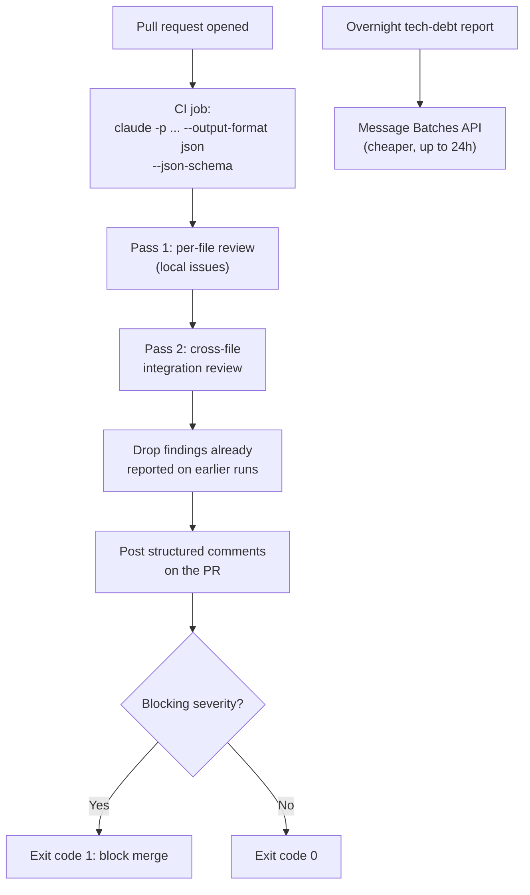

# Scenario 5: Claude Code for Continuous Integration

## 1. In One Minute

**What it is.** Claude Code runs inside CI for automated code review, test generation, and PR feedback. The goal is useful findings with few false positives.

**Domains hit:** D3 Claude Code Configuration and Workflows, D4 Prompt Engineering and Structured Output.

**Task statements:** TS 3.1 (CLAUDE.md for CI context), 3.6 (CI/CD), 4.1 (explicit criteria), 4.2 (few-shot), 4.5 (Batches API), 4.6 (multi-pass review).

**Top 3 traps**
1. Forgetting `-p` (print mode), so the job waits for input and hangs.
2. Using the Message Batches API for a blocking pre-merge check.
3. Reviewing a big PR in one pass, or telling the model to "be conservative" instead of giving explicit criteria.

## 2. Architecture Diagram

## 3. How a Good Answer Thinks

1. **Is a human waiting?** Blocking pre-merge check: real-time API. Overnight or weekly report: Message Batches API (50% cheaper, up to 24h, no latency guarantee).
2. **Non-interactive?** Use `-p` so the job never waits for input. Add `--output-format json` and `--json-schema` so the next CI step can parse the result.
3. **False positives?** Write explicit criteria: what to report, what to skip, how severe. "Be conservative" is vague.
4. **Large PR?** Per-file passes for local issues, then one integration pass for cross-file problems.
5. **Independent review.** The session that wrote the code is biased toward it. Review in a separate instance.
6. **Repeated runs.** Pass prior findings and ask for only new or unaddressed issues.
7. **Context for CI.** Put testing standards and fixtures in `CLAUDE.md` and give existing tests in context.

### Model and Sampling Notes
- Use `claude-sonnet-4-5` for coordinators and reasoning, `claude-haiku-4-5` for workers and extraction.
- With extended thinking on: omit `temperature`, leave `top_k` and `top_p` unset, and use only `tool_choice` `auto` or `none` (forced or `any` returns HTTP 400). Forced-tool extraction calls must not use thinking.
- In tool loops, return thinking blocks with their signature unchanged.
- Loops end on `stop_reason` only (`end_turn`, `tool_use`, `max_tokens`, `stop_sequence`, `pause_turn`, `refusal`). A max-iterations counter is a safety cap, not the stop rule.

## 4. Task Statement Map

| Task statement | How it shows up here | Trap |
|---|---|---|
| TS 3.1 CLAUDE.md | Project test and review standards for CI | Repeating them in every prompt |
| TS 3.6 CI/CD | `claude -p ... --output-format json --json-schema ...` | Interactive mode in CI |
| TS 4.1 Explicit criteria | Report and skip lists with severity | "Be conservative", confidence filters |
| TS 4.2 Few-shot | Examples of real issue vs acceptable pattern | Long rule lists with no examples |
| TS 4.5 Batches | Overnight report only | Batching the blocking check |
| TS 4.6 Multi-pass | Per-file passes then integration pass | One pass over many files |

## 5. Worked Example

**Setup:** A 14-file PR. The pre-merge check must finish quickly. A nightly tech-debt report also exists.

1. CI runs `claude -p "Review this PR" --output-format json --json-schema '<schema>'`. No prompt, no hang.
2. Pass 1 reviews each file alone: bare `except`, hardcoded keys outside tests.
3. Pass 2 reviews all changed files together: the client sends `auth_token`, the API expects `bearer_token`.
4. A prior run already flagged a bare `except`. The new run reports only new items; the earlier issue still counts for the merge decision.
5. Any CRITICAL or HIGH issue returns exit code 1 and blocks merge.
6. The nightly tech-debt report goes through the Batches API.

Try it offline: `scenarios/scenario_5_continuous_integration/simulation.py` (`build_ci_command`, `filter_new_findings`, `run_two_pass_review`).

## 6. Exam-Style Practice Questions

**Q1.** A CI step parses Claude's output with a script, but free-text answers break it. What should you do?
- A) Ask the model to answer "in JSON" in the prompt only.
- B) Use a regex that tolerates any text.
- C) Use `--output-format json` with `--json-schema` for a defined structure.
- D) Parse the output by hand after each run.

**Q2.** Reviews flag many style nits that developers ignore. What is the best change?
- A) Add "be conservative" to the prompt.
- B) Ask the model to attach a confidence score and drop low scores.
- C) Disable all review.
- D) Add explicit criteria listing what to report and skip, with severity, and examples.

**Q3.** After each push, the bot repeats comments from earlier runs. What is best?
- A) Pass the prior findings in context and ask for only new or unaddressed issues.
- B) Post fewer comments overall.
- C) Delete all earlier comments on each push.
- D) Review only the latest commit.

**Q4.** A weekly license-compliance report is read on Monday morning; nobody waits for it. What fits?
- A) Real-time API.
- B) Message Batches API for lower cost, with up to 24 hours of latency.
- C) Real-time API with extended thinking.
- D) Run it inside the blocking merge check.

**Q5.** Generated tests duplicate existing ones and ignore team fixtures. What helps most?
- A) Provide the existing test files and document standards and fixtures in `CLAUDE.md`.
- B) Raise the model temperature.
- C) Ask for more tests per file.
- D) Remove tests from the PR.

**Q6.** The same session that wrote a change reviews it and misses its own bugs. What is the best fix?
- A) Ask it to review harder.
- B) Use a longer thinking budget in the same session.
- C) Run the review in a separate instance that does not see the generation reasoning.
- D) Skip review for small changes.

### Answers

**Q1: C.** A fails: a prompt alone does not guarantee a structure. B fails: brittle. D fails: manual, not automated.

**Q2: D.** A fails: vague. B fails: self-reported confidence is poorly calibrated. C fails: loses value.

**Q3: A.** B fails: loses real issues. C fails: destroys history and resolved threads. D fails: misses issues in earlier commits.

**Q4: B.** A fails: pays more with no benefit. C fails: same, plus thinking cost. D fails: puts a slow, non-gating report in the merge path.

**Q5: A.** B fails: randomness does not add context. C fails: more duplicates. D fails: removes the goal.

**Q6: C.** A fails: same bias. B fails: more thinking does not remove the bias. D fails: small changes still carry bugs.

## 7. Self-Check Checklist

- [ ] I know why `-p` is needed and what it prevents.
- [ ] I can say which workload uses Batches and which does not.
- [ ] I can write report and skip criteria for a review prompt.
- [ ] I can explain per-file plus integration passes.
- [ ] I handle repeated runs by passing prior findings.

**Memory hook:** "-p to not hang, schema to parse, batch the sleepers, review in two passes."
