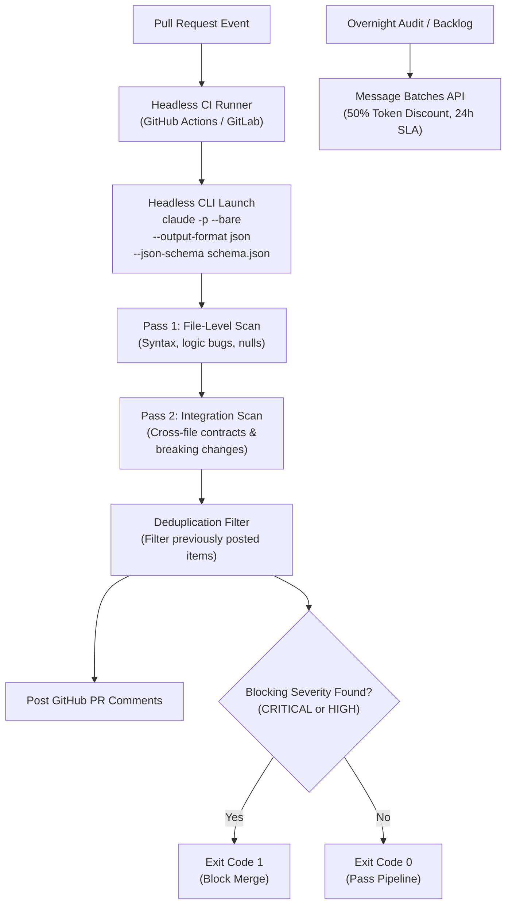
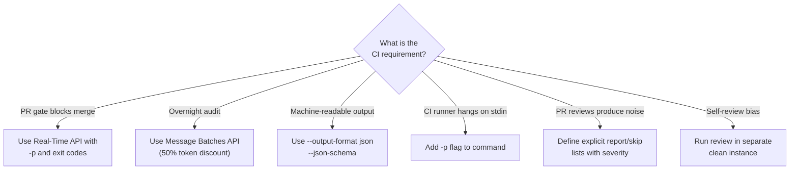

# Scenario 5: Claude Code for Continuous Integration

## 1. In One Minute

**What it is.** Running Claude Code inside automated CI/CD pipelines (such as GitHub Actions or GitLab CI) for automated pull request review, test suite generation, and pre-merge validation gates. The architectural goal is delivering high-signal, actionable feedback with zero false-positive noise, without hanging the runner or blocking developers with slow batch processing.

**Domains hit:** Domain 3 (Claude Code Configuration & Workflows), Domain 4 (Prompt Engineering & Structured Output).

**Key Task Statements:** TS 3.1 (`CLAUDE.md` context for CI runners), TS 3.6 (Headless CI/CD automation & exit codes), TS 4.1 (Explicit review criteria & severity gating), TS 4.2 (Few-shot formatting), TS 4.5 (Message Batches API vs Real-Time API trade-offs), TS 4.6 (Two-pass multi-file review).

**Top 3 Traps:**
1. **The Interactive Hang Trap**: Omitting the `-p` (print / headless) flag in CI scripts, causing the headless runner to block indefinitely waiting for user keyboard input on closed stdin.
2. **The Batching Merge Blocker Trap**: Using the asynchronous Message Batches API for a blocking pre-merge pull request check. Batches have up to a 24-hour SLA; blocking PR checks require immediate real-time API calls.
3. **The Single-Pass Monolith Trap**: Reviewing a 20-file pull request in a single undifferentiated prompt pass, or instructing the model to "be conservative" instead of providing explicit report/skip lists with severity criteria.

---

## 2. Architecture Diagram



---

## 3. How a Good Answer Thinks

Follow this decision sequence on the CCAR-F exam:

1. **Is a human waiting for the result?**
   * Blocking pre-merge PR check → Use the **Real-Time API**. Developers need feedback in minutes; you cannot make them wait up to 24 hours.
   * Overnight tech-debt scan, weekly license audit, or offline backlog triage → Use the **Message Batches API** (50% token discount across input and output tokens).
2. **Always enforce headless execution in automation**:
   * Command structure: `claude -p "<prompt>" --output-format json --json-schema <schema_file> --bare`.
   * The `-p` flag forces headless execution, streaming output to stdout and exiting cleanly.
   * The `--bare` flag ensures the CI runner does not inherit personal workstation configs or global user hooks.
3. **Eliminate False Positives via Explicit Criteria**:
   * Never use vague prompt platitudes like *"Be conservative"* or *"Only report major bugs"*.
   * Provide an explicit **Report List** (SQL injection, unhandled nulls, contract mismatches) and an explicit **Skip List** (formatting nits, import ordering handled by linters).
4. **The Two-Pass Review Pattern for Large PRs**:
   * Pass 1 (Per-File): Evaluates localized correctness, syntax, and boundary conditions within each file independently.
   * Pass 2 (Cross-File Integration): Evaluates contract compatibility between modified callers and modified callees across files.
5. **Enforce Reviewer Independence**:
   * The agent session that generated code is subject to confirmation bias. Code reviews must ALWAYS run in an **independent, clean session** that does not see the author's internal reasoning or scratchpad.
6. **State Resumption in Multi-Step Pipelines**:
   * Step 1 (Plan): Generates plan, saves `session_id`.
   * Step 2 (Execute): Resumes the approved plan using `claude --resume <session_id>`.



---

## 4. Task Statement Map

| Task Statement | How It Manifests in Scenario 5 | Exam Trap |
| :--- | :--- | :--- |
| **TS 3.1 `CLAUDE.md` in CI** | CI standards, test commands, and lint rules defined in repository `CLAUDE.md`. | Re-injecting whole testing styleguides in every CLI prompt. |
| **TS 3.6 CI/CD Automation** | `claude -p` headless execution returning exit code 0 (pass) or 1 (block). | Omitting `-p` and causing headless terminal hangs. |
| **TS 4.1 Explicit Criteria** | Rigorous severity matrices (`CRITICAL`, `HIGH`, `MEDIUM`, `LOW`) with concrete examples. | Relying on "be conservative" or subjective model confidence filters. |
| **TS 4.2 Few-Shot Examples** | Paired examples demonstrating a true security bug vs an acceptable test mock. | Long abstract rules without concrete code examples. |
| **TS 4.5 Batches API** | Overnight scans and weekly compliance audits routed to Batches API. | Routing blocking pre-merge PR checks to Batches API (24h turnaround). |
| **TS 4.6 Multi-Pass Review** | Pass 1 (file-level logic) followed by Pass 2 (system integration contracts). | Reviewing 20 files in a single unchunked prompt pass. |

---

## 5. Step-by-Step Worked Example

**Pipeline Scenario**: A developer submits a 12-file pull request refactoring payment processing. The CI pipeline must review the PR, post comments, and block the merge if critical flaws exist.

1. **Headless Execution Launch**: The GitHub Action step executes:
   ```bash
   git diff origin/main...HEAD | claude -p \
     "Review this PR diff against security and contract rules." \
     --output-format json \
     --json-schema ./ci/review-schema.json \
     --bare > review_output.json
```
   The job runs non-interactively without prompting for input.
2. **Pass 1 (File-Level Inspection)**: The review engine analyzes `payment_gateway.py` in isolation and identifies an unhandled `StripeConnectionError` that could crash the thread.
3. **Pass 2 (Integration Contract Inspection)**: The engine cross-analyzes `client.ts` and `api.py`. It detects a contract mismatch: the frontend sends `payment_method_id` as a string, but the newly updated backend expects an object `{id, provider}`.
4. **Deduplication against Prior Runs**: A previous commit on the same PR already flagged the `StripeConnectionError`. The deduplicator checks previous bot comments via the GitHub API, recognizes that this finding was already posted, and excludes it from new comments while retaining it in the blocking summary.
5. **Severity Evaluation and Process Exit**: The output schema includes:
   `{"blocking": true, "max_severity": "CRITICAL", "findings": [...]}`.
   The CI runner script parses the JSON with `jq`:
   ```bash
   if [ "$(jq .blocking review_output.json)" = "true" ]; then
     echo "Blocking review findings detected. Merge blocked."
     exit 1
   fi
```
   The build fails cleanly with exit code 1, preventing the buggy code from merging to `main`.

---

## 6. Exam-Style Practice Questions with Distractor Teardowns

### Q1. Preventing Automated Runner Deadlocks
A DevOps engineer adds Claude Code to a GitLab CI pipeline to run automated lint audits. On the first run, the CI job spins until it hits the 60-minute runner timeout, producing zero log output. What is the root cause?

- **A)** The Claude API was offline.
- **B)** The command was executed without the `-p` (print / headless) flag, causing Claude Code to block indefinitely waiting for user keyboard input on closed stdin.
- **C)** GitLab CI does not support Python runtimes.
- **D)** The repository lacked a `CLAUDE.md` file.

**Correct Answer:** B

**Distractor Teardown:**
- **A is incorrect:** An API outage would return an immediate HTTP error code, not an indefinite 60-minute terminal hang.
- **B is correct (The Interactive Hang Trap):** In non-interactive CI environments, interactive CLI programs wait forever for stdin input unless explicitly invoked in headless print mode (`-p`).
- **C is incorrect:** GitLab CI runs standard containerized environments that support all programming languages.
- **D is incorrect:** Missing `CLAUDE.md` causes Claude to use default behavior; it does not freeze process execution.

---

### Q2. Ensuring Deterministic Parsing in Downstream CI Tools
A CI pipeline runs Claude to evaluate security vulnerabilities. A downstream Python script parses Claude's output to create Jira tickets, but conversational text (e.g. *"Here are the findings from my review:"*) frequently causes JSON decoding crashes. How should the command be structured?

- **A)** Add *"Please return only JSON and do not say anything else"* to the prompt.
- **B)** Write a complex regex script that searches for curly braces in the output.
- **C)** Use `--output-format json` combined with `--json-schema <schema_path>` to enforce strict grammar-constrained JSON output.
- **D)** Require developers to manually review the raw text logs and file tickets by hand.

**Correct Answer:** C

**Distractor Teardown:**
- **A is incorrect (The Probabilistic Formatting Trap):** Natural language prompt begging remains probabilistic and occasionally outputs conversational filler.
- **B is incorrect:** Regex slicing is brittle and breaks when code snippets inside findings contain nested curly braces.
- **C is correct (Constrained Decoding Output):** Using native structured output (`--output-format json` and `--json-schema`) guarantees that output conforms strictly to the schema at the token generation layer.
- **D is incorrect:** Manual human parsing completely defeats the purpose of pipeline automation.

---

### Q3. Eliminating Stylistic Review Noise
Developers complain that the CI code review bot is flooding pull requests with low-value stylistic comments (such as indentation preferences and variable renaming suggestions), obscuring real security issues. What is the most effective architectural solution?

- **A)** Add *"Please be conservative"* to the review prompt.
- **B)** Ask the model to generate a self-reported confidence score and drop all comments below 0.90.
- **C)** Turn off the review bot entirely.
- **D)** Define explicit, structured criteria in `CLAUDE.md` or the review prompt containing an explicit Skip List (linters handle style) and Report List (logic bugs, unhandled nulls, security flaws) with severity thresholds.

**Correct Answer:** D

**Distractor Teardown:**
- **A is incorrect:** *"Be conservative"* is subjective and does not provide operational guidance on what constitutes a style nit.
- **B is incorrect (The Self-Reported Confidence Trap):** LLMs are often highly confident about stylistic suggestions; confidence filtering does not remove stylistic noise.
- **C is incorrect:** Disabling reviews removes automated security defect detection.
- **D is correct (Explicit Criteria Standards):** Providing unambiguous Skip and Report lists categorizes issues deterministically, eliminating low-value noise while catching critical flaws.

---

### Q4. API Selection: Blocking Checks vs. Asynchronous Reports
An engineering team runs two automated AI pipelines:
1. Pipeline X: A blocking pre-merge pull request gate that developers wait on before deploying to staging.
2. Pipeline Y: A weekly license and dependency compliance audit run on Sunday midnight for the compliance director.
Which API configuration matches each workload?

- **A)** Pipeline X: Message Batches API; Pipeline Y: Real-Time API.
- **B)** Pipeline X: Real-Time API with `-p`; Pipeline Y: Message Batches API with up to 24-hour turnaround for a 50% cost discount.
- **C)** Both pipelines should use the Message Batches API.
- **D)** Both pipelines should use local open-source models on developer laptops.

**Correct Answer:** B

**Distractor Teardown:**
- **A is incorrect:** Inverts the architectural requirements; developers waiting on a PR cannot wait 24 hours.
- **B is correct:** Blocking PR gates require immediate real-time responses. Asynchronous Sunday reports have zero latency sensitivity, making the Message Batches API (50% cheaper) the ideal economic choice.
- **C is incorrect (The Batching Merge Blocker Trap):** Using Batches for Pipeline X causes developers to wait up to 24 hours for a PR merge check.
- **D is incorrect:** Offline laptop models cannot run inside cloud CI runners.

---

### Q5. Deduplication across Repeated Pushes
A developer updates their pull request with a new commit. When the CI review bot executes again, it posts duplicate comments on lines that were already flagged and acknowledged in the previous commit. What architectural pattern resolves this?

- **A)** Delete all previous PR comments on every commit push.
- **B)** Ingest the prior findings payload into the review context and instruct the engine to report only new or unaddressed issues.
- **C)** Configure the bot to review only every tenth commit.
- **D)** Disable comments and print warnings only in CI terminal logs.

**Correct Answer:** B

**Distractor Teardown:**
- **A is incorrect:** Deleting past comments destroys the audit trail and removes resolved conversation threads.
- **B is correct (Stateful Finding Deduplication):** Passing prior findings allows the review step to correlate existing issues, report only fresh defects, and mark resolved items cleanly.
- **C is incorrect:** Reviewing every 10th commit allows critical bugs to slip through unnoticed.
- **D is incorrect:** Hiding findings in logs prevents developers from seeing inline code feedback in the PR UI.

---

### Q6. Eliminating Reviewer Confirmation Bias
An agent uses Claude Code to write a complex distributed consensus algorithm. To verify the code, the developer asks the exact same running session to review its own work for security flaws. The agent replies that the code is completely flawless. What failure mode occurred?

- **A)** The model's context window was exhausted.
- **B)** Reviewer Confirmation Bias: The agent session that wrote the code retains its original reasoning and assumptions in conversational memory, making it blind to its own architectural oversights.
- **C)** The developer should have increased the temperature to 1.5.
- **D)** Claude cannot review algorithms.

**Correct Answer:** B

**Distractor Teardown:**
- **A is incorrect:** Context exhaustion produces truncation errors, not self-congratulatory approvals.
- **B is correct (Independent Review Instance):** Code review must run in an independent, clean session (a "fresh instance") that evaluates only the code diff and requirements without authoring bias.
- **C is incorrect:** High temperature creates random hallucinations rather than critical analysis.
- **D is incorrect:** Claude excels at algorithmic analysis when evaluated independently.

---

## 7. Self-Check Checklist

- [ ] I always include `-p` in automated shell and CI invocations.
- [ ] I can articulate why the Message Batches API must never be used for blocking pre-merge PR checks.
- [ ] I know how to combine `--output-format json` and `--json-schema` for deterministic pipeline parsing.
- [ ] I can explain the Two-Pass Review pattern (file-level checks followed by integration contracts).
- [ ] I know why code generation and code review must run in separate, independent sessions.

**Memory Hook:** *"-p to not hang, schema to parse, batch the sleepers, review in two passes."*

**Related Practice Bank Questions:**
* [Set 5 (Skills, Subagents & Headless CI/CD): Q135, Q136, Q137, Q138, Q139, Q140, Q146](../../practice_exam_bank_300/set_05_domain2_skills_subagents_headless.md)
* [Set 6 (Prompt Caching & Economics): Q163, Q164, Q169](../../practice_exam_bank_300/set_06_domain3_prompt_caching_economics.md)
* [Set 7 (Structured Outputs & Prompting): Q186, Q198, Q199](../../practice_exam_bank_300/set_07_domain3_structured_outputs_prompting.md)
