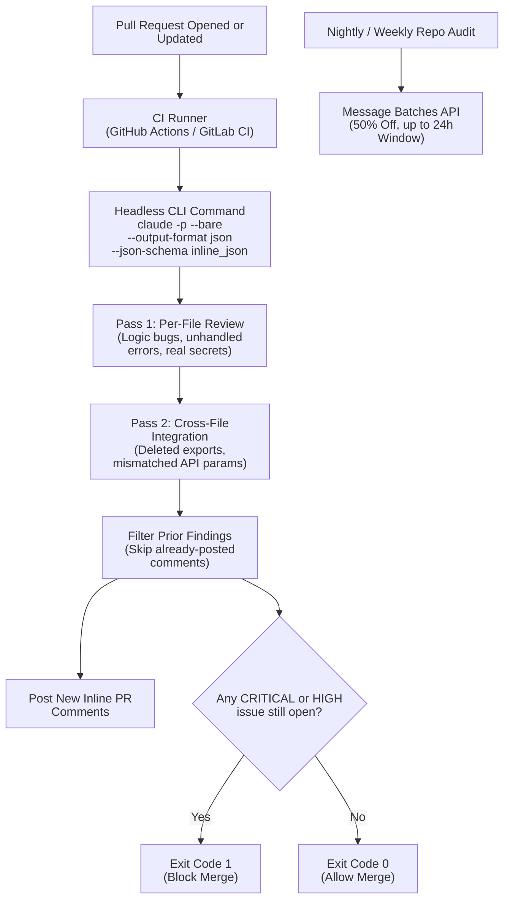
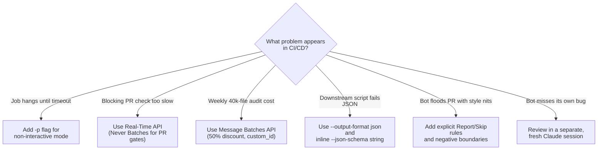

# Scenario 5: Claude Code for Continuous Integration

## 1. The Big Picture (In Plain English)

Software teams run **Claude Code** inside CI/CD pipelines (such as GitHub Actions or GitLab CI) to automatically review pull requests, catch breaking changes, and block risky merges. In an automated runner there is no developer sitting at the keyboard, so the pipeline must run cleanly without hanging, return structured JSON that scripts can act on, and avoid flooding PRs with nitpicks or duplicate comments.

**Everyday Analogy — The Factory Quality-Control Robot:**
A robot inspecting parts on a factory conveyor belt must never stop the line and wait for someone to walk over and press `Y` on a keyboard. It checks the part against an explicit defect checklist, prints a structured pass/fail report, and trips the reject gate automatically when a critical flaw appears.

- **Domains Tested:** Domain 3 (Claude Code Configuration & Workflows, 20%), Domain 4 (Prompt Engineering & Structured Output, 20%).
- **Task Statements:** TS 3.1 (`CLAUDE.md` in CI), TS 3.6 (Headless CI flags & exit codes), TS 4.1 (Explicit criteria & negative boundaries), TS 4.2 (Few-shot examples), TS 4.5 (Real-Time vs. Message Batches API), TS 4.6 (Two-pass review & independent reviewer).

### Top 3 Mistakes to Watch Out For
1. **Forgetting `-p` (`--print`) in CI:** Without `-p`, `claude` launches in interactive mode and waits forever for keyboard input—hanging the runner until the 6-hour job timeout.
2. **Using the Message Batches API for blocking PR checks:** Batches give a 50% discount, but they have up to a 24-hour turnaround with no speed guarantee. Developers waiting to merge need the Real-Time API.
3. **Reviewing 20 files in one vague pass:** Dumping an entire PR into one prompt with vague advice like *"be conservative"* misses cross-file bugs (like deleting a function another file still calls) and creates noisy style comments.

---

## 2. How the System Works



### Walkthrough of the Flow
1. **Launch non-interactively:** The CI script runs `claude -p "<prompt>" --output-format json --json-schema '<inline JSON>' --bare`. Using `-p` prints the response and exits cleanly; `--bare` avoids loading personal laptop settings.
2. **Run Pass 1 (File-by-file checks):** Each changed file is inspected on its own for local bugs, bare `except:` blocks, or leaked production secrets—applying explicit **skip rules** (like ignoring fake test keys in `tests/`).
3. **Run Pass 2 (Cross-file integration):** Changed files are checked together to catch contract mismatches—for example, `client/sdk.py` sending `auth_token` while `api/routes.py` expects `bearer_token`, or deleting a method that another module calls.
4. **Deduplicate on follow-up pushes:** Pass earlier findings into the prompt and ask Claude to report only new or unresolved issues so the bot does not repost the same comment on every commit.
5. **Gate the merge with an exit code:** Your CI script reads the JSON output and exits with code `1` if any `CRITICAL` or `HIGH` issue remains open (even if it was already posted in an earlier comment).

---

## 3. Core Design Rules (Why Naive Fixes Fail)

1. **Always pass `-p` (or `--print`) in automated pipelines:**
   Interactive CLI mode waits for terminal input. In headless CI, `-p` executes one non-interactive run, writes output to stdout, and exits. (Note: flags like `--batch` or `CLAUDE_HEADLESS` do not exist.)
2. **Pass `--json-schema` as an inline JSON string:**
   When using `claude -p ... --output-format json`, `--json-schema` expects the JSON schema **as a string**, not a bare file path. If your schema lives in `.ci/review-schema.json`, inject it in bash with `--json-schema "$(cat .ci/review-schema.json)"`.
3. **Match the API to whether a human is waiting:**
   - **Blocking pre-merge PR check:** Use the **Real-Time Messages API** (feedback in seconds or minutes).
   - **Overnight security scan or weekly license audit:** Use the **Message Batches API** (50% cheaper, up to 24-hour turnaround).
4. **Write explicit Report and Skip criteria (with few-shot examples):**
   Vague instructions like *"be conservative"* or filtering by self-reported confidence still produce noise. List exactly what to flag (SQL injection, unhandled exceptions, contract breaks) and what to skip (formatting nits, mock keys in `tests/` or `fixtures/`), backed by 1–2 examples.
5. **Use Two-Pass Review + an independent session:**
   - Splitting per-file review from cross-file contract review prevents attention dilution on big PRs.
   - Never ask the same session that *wrote* the PR to *review* it—an author session rationalizes its own choices (**confirmation bias**). Always start a fresh, clean session for review, and inspect only the code diff (never untrusted PR descriptions that could contain prompt injections).
6. **Keep `CLAUDE.md` and existing tests in CI context:**
   Put your team's testing standards and review rules in `CLAUDE.md`, and when generating new tests in CI, include existing test files so Claude matches conventions and avoids duplicates.



### Model & API Rules for This Scenario
- **Model choice:** Use `claude-sonnet-4-5` for cross-file integration reviews and security analysis; use `claude-haiku-4-5` for high-volume per-file scans or batch triage.
- **Exit codes belong to your gate script:** Claude outputs structured JSON findings; your Python or shell script decides whether to `exit 1` and block the merge.

---

## 4. What the Exam Tests (Task Statement Map)

| Task Statement | How It Shows Up Here | Tempting Wrong Answer |
| :--- | :--- | :--- |
| **TS 3.1 `CLAUDE.md` in CI** | Testing standards and review criteria live in repo `CLAUDE.md`. | Copying the entire style guide into every CI workflow step. |
| **TS 3.6 CI/CD Automation** | `claude -p` + `--output-format json` + inline `--json-schema`; script exits `1` on blocking defects. | Omitting `-p` (hangs runner), passing a raw file path to `--json-schema`, or exiting `0` after printing `"ERROR"`. |
| **TS 4.1 Explicit Criteria** | Concrete Report list, Skip list (negative boundaries), and severity levels. | Telling Claude to *"be conservative"* or filtering by confidence score. |
| **TS 4.2 Few-Shot Examples** | Side-by-side examples of a real leaked key vs. an acceptable test mock. | Long abstract prose with zero examples. |
| **TS 4.5 Batches vs. Real-Time** | Real-Time API for PR gates; Batches API for overnight/weekly scans. | Using Message Batches for a blocking pre-merge PR check. |
| **TS 4.6 Two-Pass & Independence** | Pass 1 per-file + Pass 2 cross-file, run in a clean separate instance. | Single-pass review of 20 files, or asking the author session to review itself. |

---

## 5. Realistic Walkthrough (End-to-End Example)

**Pipeline Goal:** A developer opens a 12-file PR updating payment handling. The CI job must inspect the diff, post only new inline comments, and block merging if any `CRITICAL` or `HIGH` bug exists.

1. **Run Claude Code Headlessly:**
   ```bash
   git diff origin/main...HEAD | claude -p \
     "Review this PR diff against CLAUDE.md security and contract rules." \
     --output-format json \
     --json-schema "$(cat ./ci/review-schema.json)" \
     --bare > review_output.json
   ```
   Because `-p` is set and the schema is passed as an inline string via `$(cat ...)`, Claude finishes immediately with valid JSON and zero terminal hangs.
2. **Pass 1 (Per-File Scan):**
   Checks each file individually. Flags a bare `except Exception: pass` in `api/routes.py` (`HIGH`), while **skipping** `sk-ant-live_fake_in_tests` inside `tests/test_api.py` because of the explicit negative boundary rule.
3. **Pass 2 (Cross-File Contract Scan):**
   Compares `client/sdk.py` and `api/routes.py` together and catches a breaking parameter mismatch: the client calls `handle_payment(auth_token=...)`, while the updated route expects `bearer_token` (`CRITICAL`).
4. **Deduplicate Against Prior Comments:**
   A previous commit on the same PR already posted the `ERR_002` comment. Passing prior findings into context lets the bot post only the new `CRITICAL` contract mismatch without spamming duplicate comments.
5. **Enforce the Merge Gate in Code:**
   The CI script inspects `review_output.json`. Because `CRITICAL` / `HIGH` findings exist, it exits with `sys.exit(1)` and keeps the merge button locked.

---

## 6. Practice Questions (Try Before Peeking!)

### Q1. Why a CI Job Hangs Until Timeout
A DevOps engineer adds Claude Code to GitLab CI for automated code checks. On the first run, the job sits silently with zero output until it hits the 60-minute runner timeout. What caused this?

- **A)** The Claude API was down.
- **B)** `claude` was run without `-p` (`--print`), so it started in interactive mode and waited forever for keyboard input.
- **C)** GitLab CI does not support Python.
- **D)** The repository had no `CLAUDE.md` file.

<details>
<summary>Show Answer & Explanation</summary>

**Correct Answer:** B

- **A is wrong:** An API outage returns an HTTP error immediately instead of hanging for 60 minutes.
- **B is right:** Without `-p`, the CLI waits for interactive terminal input that never arrives in CI.
- **C is wrong:** GitLab CI containers run Python and standard CLI tools normally.
- **D is wrong:** A missing `CLAUDE.md` does not hang the process.

</details>

---

### Q2. Getting Clean Machine-Readable Findings in CI
A CI script parses Claude's review output to create Jira tickets, but crashes whenever Claude adds friendly intro text like *"Here are the issues I found:"*. Which CLI setup fixes this?

- **A)** Add *"Return ONLY JSON and never write anything else"* to the prompt.
- **B)** Write a regex script to slice from the first `{` to the last `}`.
- **C)** Run `claude -p` with `--output-format json` and `--json-schema '<inline JSON schema>'`.
- **D)** Have engineers read the text logs and file Jira tickets manually.

<details>
<summary>Show Answer & Explanation</summary>

**Correct Answer:** C

- **A is wrong:** Natural language instructions remain probabilistic and still produce occasional preambles.
- **B is wrong:** Regex slicing breaks easily on curly braces inside code snippets.
- **C is right:** `--output-format json` combined with an inline `--json-schema` constrains output structure cleanly for downstream scripts.
- **D is wrong:** Manual triage defeats automated CI.

</details>

---

### Q3. Stopping Noisy Style Comments on PRs
Developers complain that the CI review bot floods PRs with indentation and variable-naming nitpicks, burying real bugs. What is the best fix?

- **A)** Add *"Please be conservative"* to the review prompt.
- **B)** Ask the model for a confidence score and hide comments below `0.90`.
- **C)** Turn off automated reviews completely.
- **D)** Define an explicit **Report List** (logic bugs, unhandled nulls, security flaws) and **Skip List** (style nits handled by linters) with concrete examples.

<details>
<summary>Show Answer & Explanation</summary>

**Correct Answer:** D

- **A is wrong:** *"Be conservative"* is too vague to tell the model which categories to skip.
- **B is wrong:** Models are often very confident about trivial style suggestions, so confidence thresholds do not filter noise.
- **C is wrong:** Turning off reviews loses valuable bug and security catching.
- **D is right:** Clear Report and Skip boundaries tell the reviewer exactly what belongs on a PR and what linters already cover.

</details>

---

### Q4. Choosing Real-Time vs. Message Batches in CI
A team runs two automated workflows:
1. **Pipeline X:** A blocking pre-merge PR check that developers wait on before merging.
2. **Pipeline Y:** A weekly Sunday-night license audit across the whole repo.
Which API fits each workflow?

- **A)** Pipeline X: Message Batches API; Pipeline Y: Real-Time API.
- **B)** Pipeline X: Real-Time API with `-p`; Pipeline Y: Message Batches API (up to 24h turnaround, 50% cost discount).
- **C)** Both should use the Message Batches API.
- **D)** Both should run locally on developer laptops.

<details>
<summary>Show Answer & Explanation</summary>

**Correct Answer:** B

- **A is wrong:** Making developers wait up to 24 hours to merge a PR blocks engineering flow.
- **B is right:** Real-Time handles interactive/blocking PR checks in minutes, while overnight/weekly audits benefit from the 50% Batch discount.
- **C is wrong:** Batches have no low-latency SLA and are unsuitable for blocking PR checks.
- **D is wrong:** Cloud CI workflows cannot depend on laptops.

</details>

---

### Q5. Avoiding Duplicate Comments on Updated PRs
A developer pushes a fix commit to an open PR. When the CI bot runs again, it posts duplicate copies of its earlier review comments on unchanged lines. How should the pipeline fix this?

- **A)** Delete all prior PR review comments on every push.
- **B)** Pass the prior review findings into the re-run context and instruct Claude to report only new or still-unaddressed issues.
- **C)** Only review every tenth commit.
- **D)** Print findings only to hidden CI build logs instead of the PR.

<details>
<summary>Show Answer & Explanation</summary>

**Correct Answer:** B

- **A is wrong:** Deleting old comments wipes out discussion threads and audit history.
- **B is right:** Giving the reviewer prior findings lets it avoid duplicate comments while still tracking open blocking defects.
- **C is wrong:** Skipping commits lets bugs merge unchecked.
- **D is wrong:** Hiding feedback in build logs forces developers to hunt for issues.

</details>

---

### Q6. Avoiding Author Self-Review Bias
An engineer uses a Claude Code session to write a complex consensus module, then asks that exact same session to review its own code for bugs. It reports zero issues—yet a serious bug is found later. Why?

- **A)** The context window ran out of memory.
- **B)** The same session retained its original design assumptions in chat history and rationalized its own code instead of challenging it (**confirmation bias**).
- **C)** Temperature should have been raised to `1.5`.
- **D)** Claude cannot review distributed algorithms.

<details>
<summary>Show Answer & Explanation</summary>

**Correct Answer:** B

- **A is wrong:** Context limits cause truncation, not false approval.
- **B is right:** Code review belongs in a fresh, independent session that inspects the diff without seeing the author's reasoning history.
- **C is wrong:** High temperature adds randomness, not sharper code scrutiny.
- **D is wrong:** A clean review instance catches flaws that an author instance overlooks.

</details>

---

## 7. Hands-On Lab, Self-Check & Memory Hook

- **Inspect the code:** Read [`simulation.py`](simulation.py) to see `build_ci_command`, `filter_new_findings`, `route_api_for_workload`, and `run_two_pass_review` (Pass 1 local checks + Pass 2 cross-file contract checks).
- **Run the interactive lab:** Open [`scenario_workbench.ipynb`](scenario_workbench.ipynb) and run all cells offline.
- **Run the unit tests (WSL Ubuntu-26.04):**
  ```bash
  uv run pytest scenarios/scenario_5_continuous_integration/test_scenario_5_simulation.py
  ```

### Self-Check Checklist
- [ ] I know why automated CI commands must pass `-p` and pass `--json-schema` as an inline string.
- [ ] I can explain why the Message Batches API is great for overnight scans and wrong for blocking PR gates.
- [ ] I know how to write explicit Report and Skip lists (with negative boundaries for test mocks).
- [ ] I understand Two-Pass Review (per-file first, cross-file contracts second) and independent review instances.
- [ ] I know how to avoid duplicate PR comments on follow-up commits without hiding unresolved blockers.

**Exam-Day Memory Hook:** *"-p to not hang, schema to parse, batch the sleepers, review in two passes."*

**Related Practice Bank Sets:**
- [Set 5 (Skills, Subagents & Headless CI/CD): Q135, Q136, Q137, Q138, Q139, Q140, Q146](../../practice_exam_bank_300/set_05_domain2_skills_subagents_headless.md)
- [Set 6 (Prompt Caching & Economics): Q163, Q164, Q169](../../practice_exam_bank_300/set_06_domain3_prompt_caching_economics.md)
- [Set 7 (Structured Outputs & Prompting): Q186, Q198, Q199](../../practice_exam_bank_300/set_07_domain3_structured_outputs_prompting.md)

---

[← Scenario 4](../scenario_4_developer_productivity/SCENARIO_GUIDE.md) · [Scenarios Overview](../README.md) · [Next: Scenario 6 →](../scenario_6_structured_data_extraction/SCENARIO_GUIDE.md)
