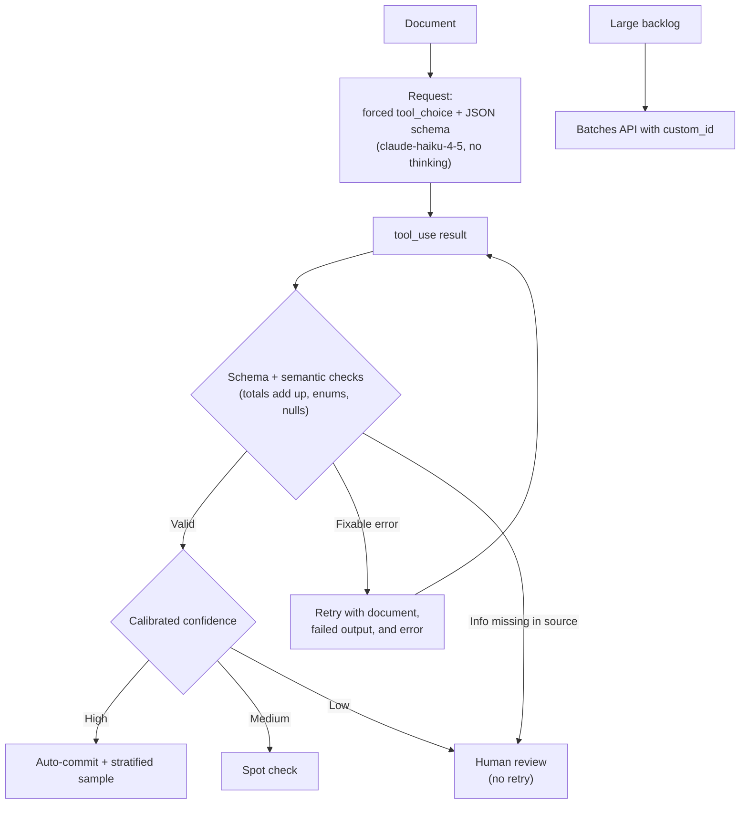

# Scenario 6: Structured Data Extraction

## 1. In One Minute

**What it is.** A pipeline extracts fields from unstructured documents (invoices, contracts, forms), validates them against JSON schemas, handles edge cases, and feeds downstream systems with high accuracy.

**Domains hit:** D4 Prompt Engineering and Structured Output, D5 Context Management and Reliability.

**Task statements:** TS 4.1 (explicit criteria), 4.2 (few-shot), 4.3 (structured output via tool use), 4.4 (validation and retry), 4.5 (Batches API), 5.5 (human review and calibration).

**Top 3 traps**
1. Believing a valid schema means correct values. A schema guarantees shape, not truth.
2. Retrying when the information is simply not in the document. The model will invent it.
3. Cutting human review because overall accuracy looks high, without checking by document type and field.

## 2. Architecture Diagram

## 3. How a Good Answer Thinks

1. **Need guaranteed shape?** Use tool use with a JSON schema (`tool_choice` forced to the extraction tool). That removes syntax errors.
2. **Schema is not truth.** Add semantic checks: totals, dates, cross-field rules.
3. **Field may be absent?** Make it nullable or optional. Required fields tempt the model to invent values.
4. **Unknown categories?** Use an enum with `other` plus a detail string, and `unclear` where the document is ambiguous.
5. **Retry only when fixable.** Send the document, the failed extraction, and the specific error. If the data is not in the document, do not retry.
6. **Backlog, no rush?** Message Batches API (50% cheaper, up to 24h, `custom_id` to match results).
7. **Human review.** Route by calibrated confidence. Keep stratified sampling by document type and field, even for high confidence.
8. **Forced tool and thinking do not mix.** Forced `tool_choice` returns HTTP 400 with extended thinking, so the extraction call uses no thinking.

### Model and Sampling Notes
- Use `claude-sonnet-4-5` for coordinators and reasoning, `claude-haiku-4-5` for workers and extraction.
- With extended thinking on: omit `temperature`, leave `top_k` and `top_p` unset, and use only `tool_choice` `auto` or `none` (forced or `any` returns HTTP 400). Forced-tool extraction calls must not use thinking.
- In tool loops, return thinking blocks with their signature unchanged.
- Loops end on `stop_reason` only (`end_turn`, `tool_use`, `max_tokens`, `stop_sequence`, `pause_turn`, `refusal`). A max-iterations counter is a safety cap, not the stop rule.

## 4. Task Statement Map

| Task statement | How it shows up here | Trap |
|---|---|---|
| TS 4.1 Criteria | Explicit field rules and edge cases | Vague "extract carefully" |
| TS 4.2 Few-shot | Examples for odd layouts and ambiguous fields | No examples for edge cases |
| TS 4.3 Tool use + schema | Forced tool, nullable optional fields, `other` enum | Believing schema fixes wrong values |
| TS 4.4 Validate and retry | Retry with error feedback; stop when data is absent | Blind retries that cause hallucination |
| TS 4.5 Batches | Backlog with `custom_id` | Batching an interactive flow |
| TS 5.5 Human review | Confidence routing and stratified audits | Trusting one overall accuracy number |

## 5. Worked Example

**Document:** A drone inspection invoice. No tax ID. Subtotal `500`, tax `0`, total `500`.

1. The request forces `extract_invoice`. The schema marks `tax_id` as nullable.
2. The model returns `tax_id: null`. Schema check passes.
3. Semantic check: subtotal plus tax equals total. Passes.
4. A second invoice has total `120` but subtotal `100` and tax `10`. The check fails. This is fixable: retry with the document, the failed output, and the message "subtotal + tax != total".
5. A third invoice has no tax number anywhere, but the schema (wrongly) requires it. A retry would invent one. Instead, make the field nullable and send low-confidence items to a human.
6. Confidence `0.95` goes to auto-commit, with a sample for audit. `0.8` gets a spot check. `0.5` goes to a human.

Try it offline: `scenarios/scenario_6_structured_data_extraction/simulation.py` (`build_extraction_request`, `validate_against_schema`, `is_retry_eligible`, `route_by_confidence`).

## 6. Exam-Style Practice Questions

**Q1.** Downstream code crashes on malformed JSON from the model. What is the most reliable fix?
- A) Say "output valid JSON" in the prompt.
- B) Post-process with a regex.
- C) Lower the temperature.
- D) Use tool use with a JSON schema and force the extraction tool.

**Q2.** Some documents have no purchase-order number, and the model sometimes invents one. What is the best schema change?
- A) Keep the field required and add "never invent" to the prompt.
- B) Make the field nullable or optional so absence can be expressed.
- C) Remove the field.
- D) Add more retries.

**Q3.** An extraction fails the check "line items sum to subtotal". What should the retry include?
- A) The same request again.
- B) Only "try again".
- C) The failure message only.
- D) The original document, the failed extraction, and the specific validation error.

**Q4.** New expense types appear that the enum does not cover. Which design handles this?
- A) A closed enum with the nearest value.
- B) A free-text field only.
- C) An enum with `other` plus a detail string, and `unclear` for ambiguous cases.
- D) Reject the document.

**Q5.** Overall accuracy is 97%, so the team wants to stop human review. What is the best response?
- A) Stop review immediately.
- B) Review only random documents.
- C) Review only the longest documents.
- D) Check accuracy by document type and field with stratified samples before reducing review.

**Q6.** A team must process 20,000 archived documents, with results needed next week. What fits?
- A) The Message Batches API with `custom_id` per request.
- B) One real-time request per document, in series.
- C) One giant request with all documents.
- D) Extended thinking on every request.

### Answers

**Q1: D.** A fails: a prompt is not a guarantee. B fails: brittle. C fails: lower temperature does not guarantee syntax.

**Q2: B.** A fails: required fields push the model to fill them. C fails: loses real data when present. D fails: retries cannot find data that is not there.

**Q3: D.** A fails: the same input gives the same mistake. B fails: gives no signal. C fails: without the document and output the model cannot fix it.

**Q4: C.** A fails: forces wrong labels. B fails: loses consistency for downstream use. D fails: throws away valid documents.

**Q5: D.** A fails: hides weak segments. B fails: random sampling misses small segments. C fails: length is not the risk factor.

**Q6: A.** B fails: slower and costs more for a non-urgent backlog. C fails: exceeds context and loses per-document results. D fails: adds cost, and thinking conflicts with a forced extraction tool.

## 7. Self-Check Checklist

- [ ] I can say what a schema guarantees and what it does not.
- [ ] I make absent-able fields nullable.
- [ ] I know when a retry helps and when it hurts.
- [ ] I can explain why forced tool choice and extended thinking do not combine.
- [ ] I keep stratified sampling even for high-confidence output.

**Memory hook:** "Schema for shape, checks for truth, null for missing, humans for the unsure."
