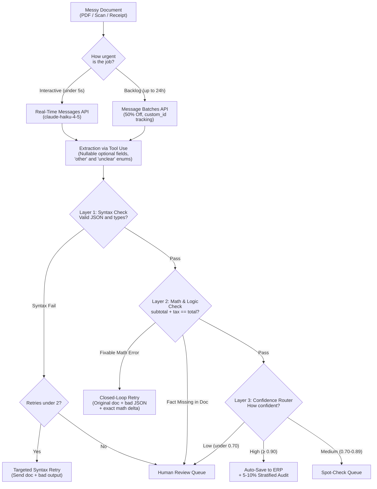
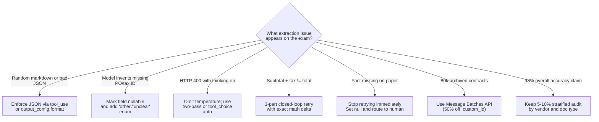

# Scenario 6: Structured Data Extraction

## 1. The Big Picture (In Plain English)

Imagine an accounts payable or medical intake pipeline that reads messy PDFs, receipts, and forms, turns them into clean JSON for a database, checks that the numbers actually add up, and sends uncertain cases to human reviewers. The core challenge is simple to state and tricky in production: **guarantee valid JSON every time, without ever letting the model invent facts that are not on the page.**

**Everyday Analogy — A Customs Declaration with an "N/A" Box:**
If a customs form has a mandatory box asking for *"Serial Number of Secondary Electronics"* and offers no `"N/A"` or `"None"` option, travelers who do not have a second device are pressured to write something anyway. In JSON extraction, marking an optional field (like `purchase_order_number` or `tax_id`) as a required non-null string forces Claude to invent a realistic fake number whenever the document omits it.

- **Domains Tested:** Domain 4 (Prompt Engineering & Structured Output, 20%), Domain 5 (Context Management & Reliability, 15%).
- **Task Statements:** TS 4.1 (Explicit criteria), TS 4.2 (Few-shot examples), TS 4.3 (Structured output via `tool_use` & schemas), TS 4.4 (Validation & retry loops), TS 4.5 (Message Batches API), TS 5.5 (Human review & stratified auditing).
- **Production Targets:** 100% valid JSON syntax, ≥ 99% accuracy on key amounts/dates, 0 fabricated missing values, and ongoing **5–10% stratified audits** even on high-confidence records.

### Top 3 Mistakes to Watch Out For
1. **Assuming valid JSON means true facts:** A JSON schema checks **shape and data types**, not truth. You still need deterministic Python checks (such as `subtotal + tax == total`) after extraction.
2. **Making optional fields required non-null strings:** If a vendor leaves off a PO number or tax ID and your schema requires a string, Claude cannot return `null`, so it invents a plausible number.
3. **Combining Extended Thinking with forced `tool_choice`:** Enabling `thinking` while forcing `tool_choice: {"type": "tool", ...}` or `"any"` causes an immediate **HTTP 400** error.

---

## 2. How the System Works



### Walkthrough of the Flow
1. **Pick the right API lane:** Interactive uploads go through the Real-Time API; large backlogs (like 80,000 archived invoices) go through the Message Batches API with `custom_id` for a 50% discount.
2. **Guarantee JSON shape with `tool_use`:** Force an extraction tool whose JSON schema marks potentially missing fields as nullable (`["string", "null"]`) and includes `"other"` / `"unclear"` escape hatches in enums.
3. **Validate math and business rules in Python:** Check `subtotal + tax == total` (allowing a `0.02` rounding tolerance) and verify line-item sums.
4. **Retry only fixable errors:** If the math is off, send a 3-part retry (original document + failed JSON + exact discrepancy). If a field is simply absent from the document, **stop retrying right away** and route to a human.
5. **Keep auditing high-confidence output:** Auto-save high-confidence records, while pulling a continuous **5–10% stratified sample** across document types and vendors to catch silent drift.

---

## 3. Core Design Rules (Why Naive Fixes Fail)

1. **Enforce JSON shape at the tool/schema layer—not by begging in the prompt:**
   Prompts like *"Return ONLY raw JSON, no backticks"* still fail a few percent of the time. Use `tool_use` (with `tool_choice: {"type": "tool", "name": "extract_invoice"}`) or native constrained decoding (`output_config.format`) so invalid syntax cannot happen.
2. **Mark missing-prone fields as nullable:**
   Any field a document might omit (`purchase_order_number`, `tax_id`) must allow `null` (`"type": ["string", "null"]`) or be optional. Otherwise grammar constraints force Claude to invent characters.
3. **Give enums an `"other"` and `"unclear"` escape hatch:**
   Fixed lists like `["airfare", "lodging", "meals", "taxi"]` break when an employee submits `"Airport Wi-Fi"`. Add `"other"` + `"unclear"` to the enum along with a nullable `"other_category_detail"` string.
4. **Never combine Extended Thinking with forced `tool_choice`:**
   The API rejects `thinking={"type": "enabled", ...}` together with `tool_choice` `"any"` or `{"type": "tool", ...}` (**HTTP 400**). Also remember to omit `temperature`, `top_p`, and `top_k` whenever thinking is enabled.
   - *Two-Pass Workaround for messy multi-page forms:* Run **Pass 1** on `claude-sonnet-4-5` with Extended Thinking and `tool_choice: "auto"` to reason through handwriting or tables; then run **Pass 2** on `claude-haiku-4-5` *without* thinking and with forced `tool_choice` to emit clean JSON cheaply.
5. **Use 3-part closed-loop retries—and fast-fail on missing facts:**
   - **When math fails:** Send back (1) the original document, (2) the faulty JSON, and (3) the exact mismatch (`subtotal 120 + tax 15 = 135 != total 150`).
   - **When a fact is physically absent from the page:** **Never retry.** Retrying cannot conjure text that is not there—it only pressures the model to hallucinate.
   - **Rounding tolerance:** Use an epsilon check (`abs(expected - total) < 0.02`) so valid commercial penny-rounding differences do not cause false failures.
6. **Never drop human review based on one overall accuracy number:**
   A `98%` overall score can hide a `40%` failure rate on rare foreign invoices (**Simpson's Paradox**). Keep continuous **5–10% stratified sampling** grouped by vendor, format, and currency.



### Model & API Rules for This Scenario
- **Model choice:** Use `claude-haiku-4-5` for fast, low-cost forced-tool extraction; pair with `claude-sonnet-4-5` in Pass 1 only when complex spatial or handwritten reasoning is needed.
- **Multi-page tables:** Keep all pages of a multi-page invoice in a **single prompt** separated by clear markers (`--- Page 2 of 3 ---`) so table rows split across pages are not lost across separate turns.

---

## 4. What the Exam Tests (Task Statement Map)

| Task Statement | How It Shows Up Here | Tempting Wrong Answer |
| :--- | :--- | :--- |
| **TS 4.1 Explicit Criteria** | Clear field definitions, ISO dates (`YYYY-MM-DD`), and null rules. | Vague prompts like *"extract all fields carefully"*. |
| **TS 4.2 Few-Shot Examples** | Realistic examples of messy receipts, discounts, and handwritten notes. | Using only tidy synthetic examples that ignore real-world layout quirks. |
| **TS 4.3 Structured Output** | `tool_use` / `output_config.format`, nullable optional fields, `"other"` enums. | Asking for markdown JSON in text, or making optional fields required strings. |
| **TS 4.4 Validation & Retries** | Code checks totals; 3-part retry for math errors; fast-fail on absent facts. | Blindly resending the same prompt, or retrying when data is missing from the page. |
| **TS 4.5 Message Batches** | Backlogs split into batches (max 100k items / 256 MB) with `custom_id`. | Putting live interactive uploads into a 24-hour batch job. |
| **TS 5.5 Stratified Audits** | Confidence routing + continuous 5–10% stratified sampling across vendors/types. | Disabling human review because the overall accuracy average is 98%. |

---

## 5. Realistic Walkthrough (End-to-End Example)

**Scenario:** An accounts payable pipeline extracts fields from international freight invoices.

1. **Design a Hallucination-Safe Schema (`EXTRACTION_SCHEMA`):**
   `tax_id` / `purchase_order_number` are declared `{"type": ["string", "null"]}`, and `expense_category` allows `["travel", "software", "office", "other", "unclear"]` with a companion `other_category_detail`.
2. **Call Extraction Without Thinking (`build_extraction_request`):**
   Calls `claude-haiku-4-5` with `tool_choice: {"type": "tool", "name": "extract_invoice"}` and **no** `thinking` or `temperature` conflict.
3. **Run Deterministic Checks (`validate_payload`):**
   - *Case A (Fixable Math Error):* First turn returns `subtotal: 100.0`, `tax: 10.0`, `total: 100.0`. Python flags `100 + 10 != 100`. The retry sends the original text, the bad JSON, and the exact math mismatch. Turn 2 corrects `total` to `110.0`.
   - *Case B (Physically Absent Field):* A cash coffee receipt says `"Total $4.50. Paid cash."` with no Tax ID anywhere. Validation sees `tax_id` is `None` and `"tax"` / `"vat"` does not appear in the source text, so `is_retry_eligible` returns `False` immediately—preventing a retry from inventing a fake Tax ID.
4. **Route & Audit (`route_by_confidence`):**
   A clean `0.96` confidence invoice goes to `STRAIGHT_THROUGH` auto-save—except `10%` of high-confidence extractions (`AUDIT_RATE = 0.10`) are randomly routed to `STRATIFIED_AUDIT` so silent template drift is caught early.

---

## 6. Practice Questions (Try Before Peeking!)

### Q1. Guaranteeing Valid JSON Syntax
An automated legal extraction pipeline frequently crashes because Claude sometimes adds intro text like *"Here is the extracted JSON:"* before the payload. What guarantees 100% valid JSON output?

- **A)** Add *"You MUST respond with valid JSON only, no markdown"* to the system prompt.
- **B)** Write a regex script that slices from the first `{` to the last `}`.
- **C)** Set temperature to `0.0` and prefill `"Output JSON:"`.
- **D)** Use Native Constrained Decoding (`output_config.format`) or `tool_use` with forced `tool_choice: {"type": "tool", "name": "..."}`.

<details>
<summary>Show Answer & Explanation</summary>

**Correct Answer:** D

- **A is wrong:** Prompt instructions are probabilistic and still occasionally produce conversational wrappers.
- **B is wrong:** Regex slicing breaks on nested braces or quotes inside extracted text.
- **C is wrong:** Lowering temperature does not enforce JSON grammar.
- **D is right:** Schema-constrained decoding and forced `tool_use` enforce valid JSON structure at token generation time.

</details>

---

### Q2. Stopping Fabricated Purchase Order Numbers
Vendors often leave off Purchase Order (PO) numbers, yet the extraction pipeline keeps inventing realistic strings like `"PO-991204"` on invoices that have no PO number at all. The schema defines `"purchase_order_number": {"type": "string"}` inside `required`. What fixes this?

- **A)** Lower temperature to `0.0` and add *"Never invent PO numbers"* to the prompt.
- **B)** Change the schema to `"type": ["string", "null"]` (or remove it from `required`) and explain in the field description to return `null` when absent.
- **C)** Add three few-shot examples showing invoices without PO numbers.
- **D)** Add a second agent afterward to search OCR text and erase missing PO numbers.

<details>
<summary>Show Answer & Explanation</summary>

**Correct Answer:** B

- **A is wrong:** When the schema forbids `null`, grammar rules override prompt warnings and force a string to be generated.
- **B is right:** Making the field nullable removes the structural pressure that forced the model to invent a string.
- **C is wrong:** Few-shot examples cannot override a strict schema that disallows `null`.
- **D is wrong:** Adding a second agent patches the symptom instead of fixing the broken schema.

</details>

---

### Q3. Fixing HTTP 400 When Combining Thinking and Forced Tools
Hospital intake forms contain messy handwritten notes, so a developer turns on Extended Thinking (`budget_tokens: 4000`) together with `tool_choice: {"type": "tool", "name": "extract_intake"}`. The API immediately rejects every call with HTTP `400`. Why, and how should it be fixed?

- **A)** Extended Thinking works only on `claude-haiku-4-5`.
- **B)** Forced `tool_choice` (`"tool"` or `"any"`) cannot be combined with Extended Thinking; switch to `tool_choice: {"type": "auto"}` or split into a two-pass pipeline (Pass 1 Sonnet thinking, Pass 2 Haiku forced tool).
- **C)** Extended Thinking requires `temperature: 1.0`, which was omitted.
- **D)** The forms exceed the context window and must be split into 500-token chunks.

<details>
<summary>Show Answer & Explanation</summary>

**Correct Answer:** B

- **A is wrong:** Extended Thinking is supported on `claude-sonnet-4-5` as well.
- **B is right:** Forced tool choice conflicts with open-ended thinking tokens; use `tool_choice: "auto"` or separate reasoning and schema formatting into two passes.
- **C is wrong:** Passing `temperature` while `thinking` is enabled actually *triggers* an HTTP `400` error (`temperature` must be omitted).
- **D is wrong:** Multi-page forms easily fit inside Claude's 200k+ token window.

</details>

---

### Q4. Handling Unexpected Expense Categories
An expense schema enforces `category: {"type": "string", "enum": ["airfare", "lodging", "meals", "ground_transport"]}`. Employees begin submitting receipts for *"conference fees"* and *"client gifts"*, causing schema errors and mislabeled meals. How should the schema be updated?

- **A)** Change `category` to an unconstrained free-text string.
- **B)** Add `"other"` and `"unclear"` to the enum, plus a nullable companion field `"category_other_detail": {"type": ["string", "null"]}`.
- **C)** Tell Claude in the prompt to pick whichever of the 4 existing categories feels closest.
- **D)** Reject all receipts outside those 4 categories and send them to security review.

<details>
<summary>Show Answer & Explanation</summary>

**Correct Answer:** B

- **A is wrong:** Free text breaks consistent accounting categories and reporting.
- **B is right:** Adding `"other"` / `"unclear"` plus a detail field handles novel receipts cleanly without corrupting existing categories.
- **C is wrong:** Forcing a gift into `"meals"` produces wrong accounting entries.
- **D is wrong:** Blocking valid business expenses creates unnecessary operational friction.

</details>

---

### Q5. Designing Effective Math Retries
Deterministic validation catches a math error on a utility bill: `subtotal ($120.00) + taxes ($15.00) != total ($150.00)` because a `$15.00 Late Fee` was missed. How should the retry work?

- **A)** Re-send the original prompt at higher temperature.
- **B)** Send a short follow-up saying only: *"The totals did not balance. Try again."*
- **C)** Send a multi-turn retry containing the original document, the faulty JSON output, and the exact mismatch (`120.00 + 15.00 = 135.00 != 150.00`) asking Claude to check for missed fees or credits.
- **D)** Never retry math errors; send every mismatch straight to a human.

<details>
<summary>Show Answer & Explanation</summary>

**Correct Answer:** C

- **A is wrong:** Resending the exact same prompt repeats the error, and higher temperature adds randomness.
- **B is wrong:** Without the original document and exact error delta, Claude cannot see what was missed.
- **C is right:** Closed-loop feedback with all three pieces lets Claude locate the missing `$15.00` line item in one bounded retry.
- **D is wrong:** A bounded retry resolves missed line items cheaply before escalating to humans.

</details>

---

### Q6. Processing an 80,000-Document Backlog Over a Weekend
An organization needs to extract records from 80,000 archived land deeds over the weekend for a Tuesday audit. Pilot tests on 200 deeds showed `98.2%` overall accuracy. What architecture is best?

- **A)** Run 100 concurrent workers on the Real-Time API and turn off human review because `98.2%` beats `95%`.
- **B)** Submit jobs via the **Message Batches API** (`/v1/messages/batches`) with unique `custom_id` keys, and keep a **5–10% stratified human audit** across deed types, eras, and counties.
- **C)** Pack 50 deeds into each 200,000-token prompt to cut request count.
- **D)** Use Batches API, but send every deed that took longer than 5 seconds to human review.

<details>
<summary>Show Answer & Explanation</summary>

**Correct Answer:** B

- **A is wrong:** Real-Time costs twice as much as Batches, and dropping human review based on one overall average hides pockets of failure (like handwritten 19th-century deeds).
- **B is right:** Weekend backlogs fit the 24-hour Batches window (50% off, `custom_id` tracking), and stratified sampling catches cohort-specific failures.
- **C is wrong:** Packing 50 documents per prompt causes cross-document mix-ups and truncation.
- **D is wrong:** Per-item latency in Batches is not exposed or correlated with extraction accuracy.

</details>

---

## 7. Hands-On Lab, Self-Check & Memory Hook

- **Inspect the code:** Read [`simulation.py`](simulation.py) to see `EXTRACTION_SCHEMA`, `build_extraction_request`, `validate_against_schema`, `is_retry_eligible`, and `StructuredExtractionPipeline`.
- **Run the interactive lab:** Open [`scenario_workbench.ipynb`](scenario_workbench.ipynb) and run all cells offline.
- **Run the unit tests (WSL Ubuntu-26.04):**
  ```bash
  uv run pytest scenarios/scenario_6_structured_data_extraction/test_scenario_6_simulation.py
  ```

### Self-Check Checklist
- [ ] I know what a JSON schema guarantees (syntax and types) and what it does not (truth and math).
- [ ] I declare optional or absent-prone fields as nullable (`["string", "null"]`) and include `"other"` / `"unclear"` in enums.
- [ ] I know when a retry helps (fixable math/format error with 3-part feedback) vs. hurts (fact missing from the page).
- [ ] I know why Extended Thinking + forced `tool_choice` returns HTTP `400` and how a two-pass pipeline solves it.
- [ ] I know why a 5–10% stratified audit stays active even when overall accuracy exceeds 98%.

**Exam-Day Memory Hook:** *"Schema for shape, code for truth, null for missing, Batches for backlog, stratified audits for trust."*

**Related Practice Bank Sets:**
- [Set 7 (Structured Outputs & Prompting): Q1–30](../../practice_exam_bank_300/set_07_domain3_structured_outputs_prompting.md)
- [Set 8 (Tool Schemas & Error Handling): Q1–30](../../practice_exam_bank_300/set_08_domain4_tool_schemas_error_handling.md)
- [Set 6 (Prompt Caching & Economics): Q1–30](../../practice_exam_bank_300/set_06_domain3_prompt_caching_economics.md)
- [Set 10 (Governance & Safety / Risk): Q1–30](../../practice_exam_bank_300/set_10_domain5_governance_safety_risk.md)

---

[← Scenario 5](../scenario_5_continuous_integration/SCENARIO_GUIDE.md) · [Scenarios Overview](../README.md) · [Next: 60-Question Practice Exam →](../MASTER_SCENARIO_PRACTICE.md)
