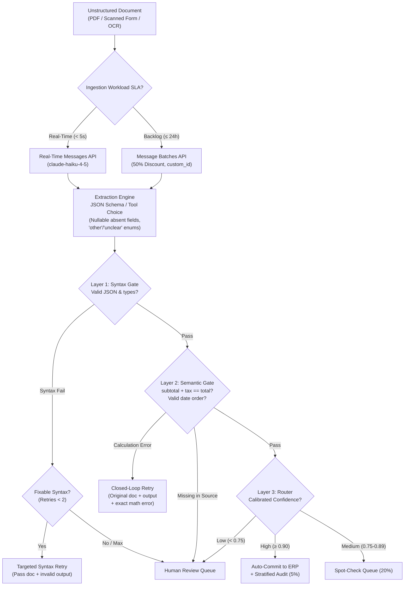
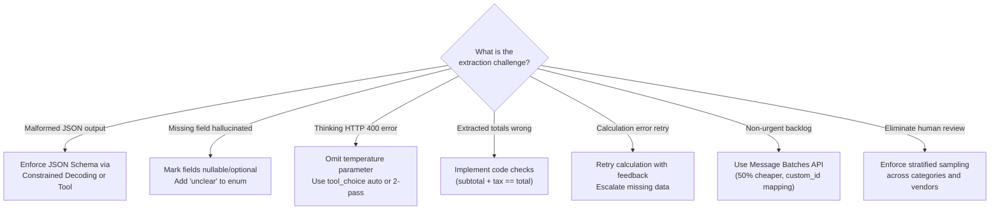

# Scenario 6: Structured Data Extraction

## 1. In One Minute

**What it is.** A production-grade document extraction pipeline that ingests complex, unstructured sources (PDF invoices, contracts, medical intake forms, utility bills, receipts), enforces strict schema constraints, performs deterministic semantic validation, corrects errors through targeted feedback loops, routes edge cases through calibrated human review, and cost-optimizes high-volume backlogs.

**Official Metrics & SLAs:**
* **Structural Compliance:** 100% valid JSON conforming to specified schemas without downstream parser crashes.
* **Semantic Accuracy:** ≥ 99.0% field-level accuracy on critical transaction attributes (amounts, dates, vendor IDs).
* **Hallucination Prevention:** Zero invented values for attributes physically absent from source documents.
* **Human Escalation:** ≤ 5% overall escalation rate, routed via calibrated confidence scoring and backed by continuous stratified quality audits.

**Domains Hit:** Domain 4 (Prompt Engineering & Structured Output - 20%), Domain 5 (Context Management & Reliability - 15%).

**Key Task Statements:**
* **TS 4.1 (Explicit Criteria):** Define unambiguous extraction guidelines, date normalization standards, currency conventions, and boundary rules.
* **TS 4.2 (Few-Shot Examples):** Provide multimodal or text few-shot examples for irregular table layouts, dense receipts, and handwritten marginalia.
* **TS 4.3 (Structured Output):** Enforce structured generation via Native Constrained Decoding (`output_config.format`) or Tool Use (`tool_choice`).
* **TS 4.4 (Validation & Bounded Retries):** Implement multi-tier validation (schema syntax + deterministic business logic) and closed-loop error correction.
* **TS 4.5 (Message Batches API):** Process asynchronous high-volume backlogs with 50% token cost reduction, 24-hour turnaround, and `custom_id` tracking.
* **TS 5.5 (Human-in-the-Loop & Auditing):** Calibrate confidence routing and maintain stratified sampling across document vendors and categories.

**Top 3 Anti-Patterns to Avoid on Exam Day:**
1. **The "Schema Guarantees Truth" Illusion:** Assuming that because an LLM returned valid JSON matching a schema, the extracted values are factually correct. A schema guarantees structural grammar and data types, not semantic truth. Deterministic programmatic checks (e.g. `subtotal + tax == total`, valid ISO country codes, checksum algorithms) must always execute post-extraction.
2. **The "Forced Required Field" Hallucination Trap:** Defining an attribute that is frequently absent in source documents (such as `purchase_order_number`, `tax_id`, or `discount_code`) as `required: true` in the JSON schema. When the attribute does not appear in the document, the model is forced by schema constraints to invent a plausible string to satisfy validation. Fields that may be absent MUST be marked `nullable: true` or optional.
3. **The Extended Thinking + Forced Tool `400 Bad Request` Crash:** Attempting to enable Extended Thinking (`thinking={"type": "enabled", "budget_tokens": ...}`) while concurrently forcing a specific tool (`tool_choice={"type": "tool", "name": "extract_invoice"}`) or `tool_choice={"type": "any"}`. The Anthropic API rejects this configuration with HTTP 400. Extraction workflows using forced tool choice must omit thinking, or use `tool_choice: {"type": "auto"}` with explicit reasoning instructions.

---

## 2. Architecture Diagram



---

## 3. How a Good Answer Thinks

Follow this architectural decision sequence on the CCAR-F exam:

1. **Enforce Structural Shape at the Grammar Level**:
   * *Never* rely on prompt-level begging (e.g., *"Please output only raw JSON without backticks"*).
   * Use **Native Constrained Decoding** (`output_config={"format": {"type": "json_schema", "schema": ...}}`) or **Tool Use** with forced tool choice (`tool_choice={"type": "tool", "name": "extract_invoice"}`).
   * Constrained decoding clamps generation at the logits level, preventing syntax errors and markdown formatting wrappers before tokens leave the inference engine.
2. **Observe Extended Thinking Compatibility Invariants**:
   * If `thinking` is enabled:
     * **Do NOT provide `temperature`** (must be omitted; passing any value returns HTTP 400).
     * **Do NOT provide `top_p` or `top_k`** (leave unset).
     * **Do NOT force tool choice** (`tool_choice: "any"` or `tool_choice: {"type": "tool", ...}` returns HTTP 400). Only `auto` or `none` is permitted.
   * *Two-Pass Extraction Architecture:* When deep document comprehension or messy handwritten table reasoning is needed, execute Pass 1 with `claude-sonnet-4-5` using Extended Thinking (`tool_choice: "auto"` or free-form reasoning) to analyze relationships and transcribe unformatted text. Execute Pass 2 with fast `claude-haiku-4-5` using forced schema extraction to convert Pass 1 analysis into validated JSON.
3. **Eliminate Hallucinations for Missing Data**:
   * Real-world documents frequently omit fields: missing PO numbers, absent tax exemptions, unlisted discount codes.
   * If a field is declared `required: true` with `type: "string"`, the LLM is forced by grammar constraints to output characters. It will fabricate a realistic number.
   * *The Invariant:* Any attribute that might be absent MUST be marked nullable (`type: ["string", "null"]`) or omitted from the `required` array.
4. **Resilient Categorization via Enums with Fallbacks**:
   * Fixed enums (`["office_supplies", "travel", "software"]`) fail when real documents introduce novel categories (e.g., "catering", "freight surcharge").
   * *The Pattern:* Always include `"other"` and `"unclear"` in enum values, paired with a companion nullable string property `"other_description"`.
5. **Architect Closed-Loop Error Correction**:
   * A blind retry (resending the identical prompt) repeats the model's stochastic hallucination or error.
   * A retry that sends *only* the error message leaves the model without the context needed to repair its answer.
   * *The Invariant:* Every error correction retry payload must contain 3 items:
     1. The **original document text or image**.
     2. The **previously extracted (faulty) JSON payload**.
     3. The **specific, deterministic validation error** (e.g., `"Validation Error: Stated total 1500.00 does not equal subtotal 1200.00 + tax 250.00. Please inspect line items on Page 2."`).
   * *The Boundary:* If deterministic validation fails because the data is *physically missing* from the source document, DO NOT RETRY. Retrying cannot discover nonexistent text; it will induce hallucination. Route immediately to human review.
6. **Economics of Backlogs vs Real-Time**:
   * Interactive user flows (customer uploading an ID during signup) require **Real-Time Messages API** (< 5s latency).
   * Backlog digestion (25,000 archived invoices, overnight document scanning) requires the **Message Batches API**:
     * 50% discount across both input and output tokens.
     * Turnaround SLA up to 24 hours.
     * Correlation maintained via developer-supplied `custom_id` strings.
7. **Human-in-the-Loop & Stratified Auditing**:
   * An aggregate accuracy metric (e.g., "98.5% across all documents") masks severe sub-segment failure (e.g., 99.8% on standard US receipts, but 35% on multi-currency foreign bills of lading).
   * Even when confidence scores exceed 0.90 and auto-commit is enabled, maintain continuous **stratified sampling** (3–5% random sample) segmented by vendor, document format, and language to detect model drift.



---

## 4. Task Statement Map

| Task Statement | How It Manifests in Scenario 6 | CCAR-F Exam Trap |
| :--- | :--- | :--- |
| **TS 4.1 Explicit Criteria** | Unambiguous schema field descriptions, ISO 8601 date formatting, standard currency codes, and null-handling criteria. | Using vague instructions like *"extract all fields carefully"* instead of strict per-field constraints. |
| **TS 4.2 Few-Shot Prompting** | Paired few-shot examples illustrating complex edge cases (e.g., discounted line items, handwritten tax exemptions). | Providing only simple synthetic examples that fail to reflect production document layout messiness. |
| **TS 4.3 Structured Output** | Enforcing extraction via Native Constrained Decoding (`output_config.format`) or Tool Use (`tool_choice`). | Relying on system prompt pleading (`"Output only raw JSON"`) or post-hoc regex parsing. |
| **TS 4.4 Validation & Retry** | Deterministic post-extraction code checks (totals, date ranges) and structured 3-part retry payloads. | Repeating identical failed prompts, or retrying when data is physically absent from the source. |
| **TS 4.5 Message Batches** | Offloading non-urgent document backlogs to the Batches API for a 50% token cost reduction. | Routing blocking interactive requests to the 24-hour Batches API, or omitting `custom_id` mapping. |
| **TS 5.5 Human-in-the-Loop** | Triaging extractions by calibrated confidence and maintaining continuous stratified quality sampling. | Removing human review due to high aggregate accuracy, ignoring class and vendor distribution skews. |

---

## 5. Step-by-Step Worked Production Example

**Production Scenario:** An enterprise accounts payable system processes international commercial freight invoices. Invoices arrive as unstructured text extracts. The system must extract vendor, invoice number, purchase order number, line items, subtotal, tax, and total amount, handling missing attributes and foreign currencies without hallucination.

### Step 1: Resilient JSON Schema Design
The schema defines nullable attributes for values that may be missing, and enums with an `"other"` fallback for expense categories.
```json
{
  "name": "extract_invoice",
  "description": "Extract structured transaction data from an accounts payable invoice.",
  "input_schema": {
    "type": "object",
    "properties": {
      "vendor_name": { "type": "string" },
      "invoice_number": { "type": "string" },
      "purchase_order_number": { "type": ["string", "null"] },
      "invoice_date": { "type": "string", "pattern": "^\\d{4}-\\d{2}-\\d{2}$" },
      "currency": { "type": "string", "maxLength": 3 },
      "line_items": {
        "type": "array",
        "items": {
          "type": "object",
          "properties": {
            "description": { "type": "string" },
            "quantity": { "type": "number" },
            "unit_price": { "type": "number" },
            "total_amount": { "type": "number" }
          },
          "required": ["description", "quantity", "unit_price", "total_amount"]
        }
      },
      "subtotal": { "type": "number" },
      "tax_amount": { "type": "number" },
      "total_amount": { "type": "number" },
      "category": {
        "type": "string",
        "enum": ["freight", "customs", "warehousing", "fuel_surcharge", "other", "unclear"]
      },
      "category_other_description": { "type": ["string", "null"] }
    },
    "required": [
      "vendor_name",
      "invoice_number",
      "purchase_order_number",
      "invoice_date",
      "currency",
      "line_items",
      "subtotal",
      "tax_amount",
      "total_amount",
      "category"
    ]
  }
}
```

### Step 2: Extraction Invocation
The request targets `claude-haiku-4-5` with forced tool execution and no Extended Thinking:
```json
{
  "model": "claude-haiku-4-5",
  "tools": [ { "name": "extract_invoice", ... } ],
  "tool_choice": { "type": "tool", "name": "extract_invoice" },
  "messages": [
    {
      "role": "user",
      "content": "Extract the freight invoice data:\n\nVENDOR: Nordic Maritime Express\nINV #: NME-98214\nDATE: Oct 24, 2026\nCURRENCY: EUR\n\nItems:\n1. Container Drayage 40ft: 800.00\n2. Port Terminal Handling: 250.00\n\nSubtotal: 1050.00\nVAT (10%): 105.00\nTotal Due: 1155.00\nNOTE: No PO reference provided by carrier."
    }
  ]
}
```

### Step 3: Layer 1 & Layer 2 Validation Execution
1. **Model Output Received:**
   ```json
   {
     "vendor_name": "Nordic Maritime Express",
     "invoice_number": "NME-98214",
     "purchase_order_number": null,
     "invoice_date": "2026-10-24",
     "currency": "EUR",
     "line_items": [
       { "description": "Container Drayage 40ft", "quantity": 1, "unit_price": 800.00, "total_amount": 800.00 },
       { "description": "Port Terminal Handling", "quantity": 1, "unit_price": 250.00, "total_amount": 250.00 }
     ],
     "subtotal": 1050.00,
     "tax_amount": 105.00,
     "total_amount": 1155.00,
     "category": "freight",
     "category_other_description": null
   }
   ```
2. **Layer 1 Check (Schema Syntax):**
   * All required keys present. `purchase_order_number` is `null`, which conforms to `["string", "null"]`. Date matches `^\d{4}-\d{2}-\d{2}$`. Enum `"freight"` is valid. **PASS**.
3. **Layer 2 Check (Semantic Business Logic):**
   * Line items sum: `800.00 + 250.00 = 1050.00`. Matches `subtotal`. **PASS**.
   * Math invariant: `subtotal (1050.00) + tax_amount (105.00) = 1155.00`. Matches `total_amount`. **PASS**.
   * Foreign currency check: `EUR` is on supported settlement currency list. **PASS**.

### Step 4: Closed-Loop Retry Simulation (When Math Fails)
Suppose a secondary invoice states: Subtotal `100.00`, Tax `10.00`, but Total `125.00`.
1. Deterministic validation code triggers:
   `AssertionError: subtotal (100.00) + tax (10.00) != total (125.00). Difference = 15.00.`
2. The orchestrator checks if the document contains line items or discounts that account for the discrepancy.
3. The retry request is constructed:
   ```json
   [
     { "role": "user", "content": "<original document text>" },
     { "role": "assistant", "content": [ { "type": "tool_use", "name": "extract_invoice", "input": { ... } } ] },
     {
       "role": "user",
       "content": [
         {
           "type": "tool_result",
           "tool_use_id": "toolu_01...",
           "content": "Semantic Validation Error: Calculated total (subtotal 100.00 + tax 10.00 = 110.00) does not match extracted total 125.00. Please re-read the invoice to verify whether an additional shipping charge of 15.00 was listed as a line item."
         }
       ]
     }
   ]
   ```
4. The model corrects its extraction by adding the missing `"Hazardous Cargo Surcharge: 15.00"` line item.

### Step 5: Confidence Routing & Stratified Audits
* Calibrated confidence score: `0.96` (clean OCR, zero math discrepancies, known vendor ID).
* Action: **Auto-committed** directly to ERP.
* Audit Engine: Document falls into the random 5% stratified audit pool for "Nordic Maritime Express" and "freight" category to guarantee long-term human calibration.

---

## 6. Exam-Style Practice Questions

### Question 1
An engineering team is building an automated legal extraction service. Downstream relational databases frequently crash because the LLM occasionally returns explanatory conversational text (e.g., *"Here is the extracted agreement details:"*) surrounding the JSON payload, and occasionally generates unquoted property keys. Which architectural change guarantees 100% syntactically valid JSON extraction without conversational formatting?

* A) Prepend a strong system instruction: *"You are an API endpoint. You MUST respond with 100% strictly valid JSON only. Never include markdown fences or conversational preambles."*
* B) Implement a post-processing regex pipeline that searches for the first `{` and last `}` and passes the substring through a JSON parser with a retry loop.
* C) Lower the model temperature to `0.0` and append `"Output JSON:"` as a prefilled assistant message turn.
* D) Configure the API call using Native Constrained Decoding with a JSON schema (`output_config.format`) or Tool Use with a forced schema tool (`tool_choice: {"type": "tool", "name": "..."}`).

#### Answer: D
* **Why D is Correct:** Native Constrained Decoding and forced Tool Use constrain token generation at the logits level during inference. The decoding algorithm only samples tokens that conform to the JSON schema grammar, mathematically preventing markdown backticks, conversational preamble, and malformed syntax before output leaves the model.
* **Distractor Breakdown:**
  * **Option A is Incorrect:** Natural language prompt begging is probabilistic. Even with strict instructions, complex or ambiguous documents can trigger conversational preambles or syntax anomalies.
  * **Option B is Incorrect:** Regex substring extraction is brittle; it fails on nested structures, unescaped quotes within document text, and invalid JSON grammar.
  * **Option C is Incorrect:** Setting temperature to 0.0 decreases token entropy but does not constrain output grammar. Assistant prefilling is deprecated or unsupported in modern structured endpoints compared to native schema constraints.
* **Anti-Pattern Alert:** Never rely on prompt instructions to guarantee machine-readable serialization syntax when native grammar constraints are available.

---

### Question 2
An enterprise invoice processing pipeline encounters documents where the "Purchase Order Number" (PO#) is frequently omitted by the vendor. In testing, the extraction system consistently invents realistic-looking PO numbers (e.g., `"PO-991204"`) for invoices that have no purchase order anywhere on the page. Inspection reveals the JSON schema defines `"purchase_order_number": {"type": "string"}` in the `required` list. What is the root cause and the most robust architectural fix?

* A) The model temperature is too high; set temperature to `0.0` and add *"Do not invent PO numbers"* to the prompt.
* B) The schema enforces a mandatory string type; update the schema to declare the field nullable (`type: ["string", "null"]`) or remove it from the `required` array.
* C) The prompt lacks few-shot examples; add three few-shot examples showing invoices with missing PO numbers.
* D) Implement a post-extraction verification agent that searches the raw document OCR text for the extracted PO number and deletes it if not found.

#### Answer: B
* **Why B is Correct:** When an attribute is marked as `required` with `type: "string"`, the constrained decoding engine or tool-use grammar forces the model to produce characters matching that type. Because `null` is grammatically disallowed by the schema, the model is compelled to fabricate a string to satisfy structural validation. Making the field nullable (`type: ["string", "null"]`) allows the model to output `null` honestly when the attribute is absent.
* **Distractor Breakdown:**
  * **Option A is Incorrect:** Prompting *"do not invent"* directly conflicts with the grammar rule requiring a string. When prompt instructions conflict with schema constraints, grammar constraints win or cause parsing crashes.
  * **Option B is the Root Fix.**
  * **Option C is Incorrect:** Few-shot examples cannot override a schema constraint that strictly disallows `null`.
  * **Option D is Incorrect:** Adding a secondary verification agent is an expensive, high-latency band-aid that treats the symptom rather than fixing the broken schema definition.
* **Anti-Pattern Alert:** The Forced Required Field Hallucination Trap. Never mark an attribute as mandatory if real-world source documents can omit it.

---

### Question 3
A developer is configuring an extraction pipeline for complex hospital patient intake forms. Because the forms contain dense, handwritten margin notes and complex clinical history, the developer enables Extended Thinking (`budget_tokens: 4000`) and forces structured extraction using `tool_choice: {"type": "tool", "name": "extract_intake"}`. Upon executing the request against the Claude API, the request fails immediately with an HTTP 400 Client Error. What is the architectural reason for this failure and how should it be resolved?

* A) Extended Thinking is only supported on `claude-haiku-4-5`; the developer must downgrade the model.
* B) Forced tool choice (`type: "tool"` or `"any"`) is incompatible with Extended Thinking in the API specification; the developer must set `tool_choice: {"type": "auto"}` or separate reasoning and extraction into a two-pass pipeline.
* C) Extended Thinking requires `temperature` to be explicitly set to `1.0`; the developer omitted the temperature parameter.
* D) Hospital intake forms exceed the maximum context window of Claude models; the document must be chunked into 500-token snippets.

#### Answer: B
* **Why B is Correct:** In the Claude API specification, Extended Thinking cannot be combined with forced tool choice (`{"type": "tool", ...}` or `{"type": "any"}`). Forcing a tool immediately constrains the generation logits to tool emission, precluding the open-ended token reasoning required by Extended Thinking, resulting in an HTTP 400 error. The solution is either to use `tool_choice: {"type": "auto"}` (allowing thinking before voluntary tool execution) or to implement a two-pass pipeline (Pass 1: reasoning with Sonnet; Pass 2: extraction with Haiku and forced tool choice).
* **Distractor Breakdown:**
  * **Option A is Incorrect:** Extended Thinking is primarily used on `claude-sonnet-4-5` for deep reasoning; it is not restricted to Haiku.
  * **Option C is Incorrect:** When Extended Thinking is enabled, providing `temperature` is explicitly rejected with HTTP 400 (temperature must be omitted).
  * **Option D is Incorrect:** Claude 4.5 models feature a 200,000+ token context window, easily accommodating complete multi-page medical forms.
* **Anti-Pattern Alert:** Extended Thinking + Forced Tool Conflict. Always remember: `thinking` requires `tool_choice: "auto"` or `"none"`, and `temperature` must be completely omitted.

---

### Question 4
An expense management extraction system uses an enum to classify receipts into corporate accounting buckets: `category: {"type": "string", "enum": ["airfare", "lodging", "meals", "ground_transport"]}`. Recently, employees submitted receipts for "conference registration fees" and "client gifts". The extraction pipeline began throwing schema validation errors and misclassifying client gifts as "meals". How should the schema and prompt be redesigned to handle evolving business categories robustly?

* A) Change `category` to an unconstrained free-text string and instruct the model to write whatever category seems appropriate.
* B) Expand the enum to include `"other"` and `"unclear"`, and add a companion nullable field `"category_other_detail": {"type": ["string", "null"]}`.
* C) Instruct the model in the prompt to pick the closest existing category whenever a new category appears.
* D) Reject all receipts that do not match the four existing categories and route them to executive security review.

#### Answer: B
* **Why B is Correct:** In production extraction systems, closed enums without fallbacks cause two major failure modes: validation rejection crashes when the model refuses to guess, or hallucinated misclassifications when the model is forced to choose the nearest incorrect enum value (e.g., labeling a gift as "meals"). Providing `"other"` and `"unclear"` with a descriptive companion string maintains strict typing while capturing long-tail categories cleanly.
* **Distractor Breakdown:**
  * **Option A is Incorrect:** Reverting to free text eliminates categorical consistency, making automated ledger posting and downstream database aggregation impossible.
  * **Option C is Incorrect:** Forcing the model to pick the "closest" value produces corrupt accounting records (misallocating gifts or registration fees to travel/meals).
  * **Option D is Incorrect:** Rejecting legitimate business expenses creates unnecessary administrative friction and operational gridlock.
* **Anti-Pattern Alert:** Closed Enum Rigidity. Always provide an explicit `"other"` / `"unclear"` escape hatch in enum schemas to capture out-of-distribution real-world data.

---

### Question 5
A document extraction system parses utility bills. The JSON schema validation passes, but deterministic code validation reveals an invariant failure: `subtotal (\$120.00) + taxes (\$15.00) != total_amount (\$150.00)`. Investigation shows the document contained a "\$15.00 Late Fee" that the model overlooked. How should the automated retry mechanism be architected to resolve this error reliably?

* A) Resend the original prompt and document text to the model with an increased temperature to encourage exploratory generation.
* B) Send a new message containing only the error text: *"The totals did not balance. Try again."*
* C) Construct a multi-turn conversation providing the original document, the model's faulty JSON output, and a precise error message stating: *"Validation Error: subtotal (120.00) + taxes (15.00) = 135.00, which does not equal total_amount (150.00). Please re-read the document for additional fees or credits."*
* D) Immediately route the document to a human operator, because any schema-compliant output that fails semantic math indicates a corrupted model state that cannot be fixed via prompting.

#### Answer: C
* **Why C is Correct:** Effective closed-loop error correction requires three essential pieces of context: the ground-truth source document, the model's previous attempt, and the exact deterministic math delta. This provides the LLM with the precise signal required to locate the discrepancy (the missing \$15.00 fee) and correct its output without repeating the error.
* **Distractor Breakdown:**
  * **Option A is Incorrect:** Resending the exact same prompt without error feedback simply repeats the mistake. Increasing temperature increases variance and hallucination risk.
  * **Option B is Incorrect:** A vague message without the prior response or specific math discrepancy gives the model insufficient context to determine what failed or where to look.
  * **Option D is Incorrect:** Minor calculation or line-item omission errors are frequently and efficiently fixed in a single bounded retry turn (max 1–2 retries), avoiding expensive human intervention.
* **Anti-Pattern Alert:** The Blind Retry Trap. Retrying without targeted, deterministic error feedback burns tokens and reproduces identical failure modes.

---

### Question 6
An organization must extract structured records from 80,000 archived historical land deed documents over the weekend. The data is needed on Tuesday morning for a regulatory audit. The extraction pipeline requires high throughput, budget efficiency, and reliable auditability. In preliminary testing on 200 documents, the system achieved 98.2% aggregate field accuracy. Which architectural approach best satisfies the operational requirements?

* A) Deploy a pool of 100 concurrent workers querying the Real-Time Messages API (`/v1/messages`), and eliminate human review entirely since 98.2% accuracy exceeds the 95% audit threshold.
* B) Submit the documents using the Message Batches API (`/v1/messages/batches`) with unique `custom_id` parameters, and implement a stratified human review queue sampling 5% of records across deed types, eras, and counties.
* C) Concatenate all 80,000 documents into a series of massive 200,000-token prompts using Claude Sonnet 4.5, extracting 50 documents per prompt to minimize request overhead.
* D) Route all 80,000 documents through the Message Batches API, but hold all records in quarantine until a human reviewer manually inspects every document that took more than 5 seconds to process.

#### Answer: B
* **Why B is Correct:** The Message Batches API provides a 50% discount on input and output tokens and is designed specifically for non-blocking asynchronous processing with an SLA up to 24 hours. The `custom_id` allows deterministic mapping between source document IDs and batch results. Furthermore, eliminating human review based on aggregate accuracy is an exam trap: aggregate accuracy masks localized failure modes (e.g., 99.9% on typed deeds, but 40% on handwritten 19th-century deeds). Implementing a **stratified sample** ensures robust governance across all document cohorts.
* **Distractor Breakdown:**
  * **Option A is Incorrect:** Real-Time Messages API costs 2x more than Batches API, risks rate-limit throttling (HTTP 429) across 100 concurrent workers, and eliminating human review based on aggregate metrics violates governance standards.
  * **Option C is Incorrect:** Packing multiple documents into a single prompt causes severe context dilution, cross-document hallucination, and truncation risks.
  * **Option D is Incorrect:** In the Batches API, execution time per item is not surfaced or correlated with accuracy; holding all documents defeats the purpose of automated batch extraction.
* **Anti-Pattern Alert:** The Aggregate Accuracy Fallacy. Never eliminate human review based on an overall percentage; always enforce stratified auditing across sub-distributions.

---

## 7. Self-Check Mastery Rubric

Before sitting for the CCAR-F exam, verify that you can explain each invariant without hesitation:

* [ ] **Constrained Decoding vs Prompting:** I can articulate why native grammar-level JSON constraints or tool-use schemas are mandatory for structured extraction, and why prompt instructions alone are insufficient.
* [ ] **Extended Thinking Restrictions:** I know that Extended Thinking rejects `temperature`, `top_p`, `top_k`, and forced tool choice (`"any"` or specific tool names) with HTTP 400.
* [ ] **Nullable Schema Protection:** I always declare optional or missing document fields as nullable (`type: ["string", "null"]`) to prevent the model from inventing data.
* [ ] **Enum Resilience:** I include `"other"` and `"unclear"` in categorical enums alongside a free-text companion field to accommodate real-world variance.
* [ ] **Closed-Loop Retry Contract:** I know that error correction retries must include the original document, the previous faulty output, and the specific deterministic error message.
* [ ] **Batches API Economics & SLA:** I understand that the Message Batches API yields a 50% cost reduction for non-urgent tasks (≤ 24h SLA) and uses `custom_id` for request correlation.
* [ ] **Stratified Quality Audits:** I understand why aggregate accuracy numbers are misleading, and how stratified sampling protects against skewed sub-cohort failures.

---

### Related Practice Question Bank References
* **Domain 4 (Prompting & Structured Output):**
  * [Set 7 (Structured Outputs & Prompting): Q1–30](../../practice_exam_bank_300/set_07_domain3_structured_outputs_prompting.md)
  * [Set 8 (Tool Schemas & Error Handling): Q1–30](../../practice_exam_bank_300/set_08_domain4_tool_schemas_error_handling.md)
* **Domain 3 (Cost Optimization & Batch Processing):**
  * [Set 6 (Prompt Caching & Economics): Q1–30](../../practice_exam_bank_300/set_06_domain3_prompt_caching_economics.md)
* **Domain 5 (Governance & Reliability):**
  * [Set 10 (Governance & Safety / Risk): Q1–30](../../practice_exam_bank_300/set_10_domain5_governance_safety_risk.md)

**Exam-Day Memory Hook:** *"Schema for shape, deterministic code for truth, nullable for missing, Batches for backlog, stratified audits for trust."*
